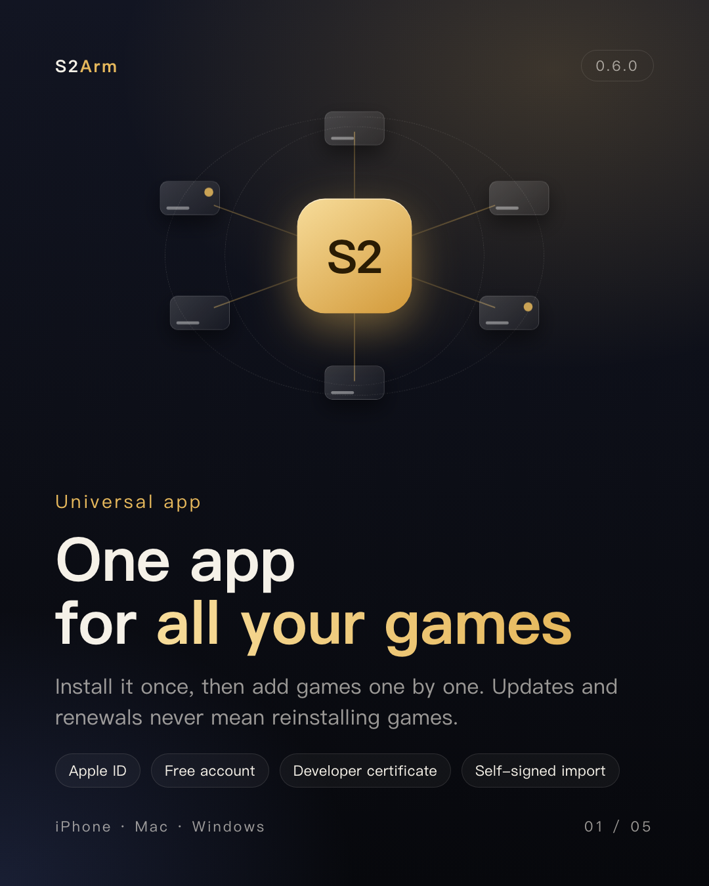
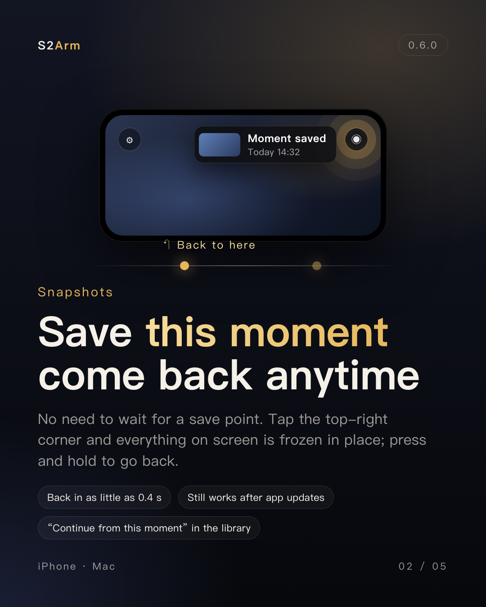

<p align="center"><a href="https://s2arm.com"></a><br><a href="https://s2arm.com">s2arm.com</a></p>

<p align="center">[简体中文](README.zh-CN.md) · [繁體中文](README.zh-TW.md) · [English](README.md) · [日本語](README.ja.md) · [Español](README.es.md) · [Français](README.fr.md)</p>

> [!NOTE]
> **[s2arm.com](https://s2arm.com) es la web oficial de S2Arm.** S2Arm es gratuito y de código abierto, y nunca acepta donaciones; consigue S2Arm solo en [s2arm.com](https://s2arm.com) o en este repositorio de GitHub.

**Tus propios juegos de Switch, de forma nativa en iPhone, iPad y Mac.** El código del juego se reescribe a ARM64 nativo y se ejecuta directamente en el procesador del dispositivo; los gráficos van directos a Metal. Desde la 0.6.0, en el teléfono solo hay una App S2Arm y todos los juegos están en su biblioteca: en el lanzador de Mac o Windows, envía los juegos uno a uno con «Enviar al iPhone» y a jugar.

Plataformas: iPhone / iPad (iOS / iPadOS 18 o posterior) · Mac (Apple silicon, macOS 15 o posterior) · Lanzador para Mac o Windows · Licencia: Apache-2.0 · **Los juegos los pones tú**

[Descargar el lanzador](https://s2arm.com) · [Todas las versiones](https://github.com/jhaizhou-ops/S2Arm/releases) · [Pruebas](docs/validation/EVIDENCE.md)

<p align="center"></p>

## Novedades de la 0.6.0

### Una App para todos tus juegos

Instala S2Arm en el teléfono una sola vez y luego añade los juegos uno a uno. Al actualizar o renovar la firma de S2Arm no hay que volver a instalar los juegos, y las partidas guardadas siguen ahí. Puedes firmar con un Apple ID gratuito o de pago o con un certificado de desarrollador, o firmarlo tú mismo e importarlo.

### Instantáneas: guarda este momento y vuelve cuando quieras

No hace falta esperar al punto de guardado del juego. Dentro del juego, toca el ◉ de la esquina superior derecha y se guarda el momento en que estás; mantenlo pulsado y elige «Volver al momento guardado» para regresar. La próxima vez que abras la biblioteca, toca «Continuar desde este momento», arriba del todo, y entras directamente.

- Cada juego guarda solo la instantánea más reciente; la nueva sustituye a la anterior.
- Una instantánea ocupa espacio en el teléfono (el tamaño depende del juego). Mantén pulsado para eliminarla y liberar el espacio; también puedes desactivarlas en Ajustes.
- Una instantánea solo funciona en el dispositivo que la guardó; después de actualizar S2Arm sigue funcionando.

<p align="center"></p>

### Un archivo para seguir jugando en otro dispositivo

Cada juego se puede exportar como archivo .s2arm; impórtalo en otro de tus dispositivos y a jugar: el teléfono lo firma por su cuenta. Cada juego ocupa una sola copia, y en «Liberar espacio» ves de un vistazo cuánto ocupan el juego, las partidas guardadas y las instantáneas.

### Todos los sombreadores listos: fluido desde la primera partida

Los sombreadores que necesita el juego se preparan al enviarlo, así que la primera vez que entras en una zona nueva ya no hay tirones. Los diagnósticos de los jugadores reunieron **26,809** sombreadores de 69 juegos que fallaban al compilar en el dispositivo. Sin contar 278 entradas dañadas que no se pueden leer como sombreadores, ahora compilan **los 26,531** restantes.

Cómo se cuenta: el porcentaje solo incluye los sombreadores que **habían fallado al compilar** en los diagnósticos de jugadores; no es una tasa de cobertura de todos los sombreadores. De los 98 restantes, 91 no eran sombreadores, sino memoria leída mal durante la captura (captura corregida), y los otros 7 se han corregido de raíz.

Nota: en iPhone, las canalizaciones precompiladas solo se generan al enviar el juego con ese iPhone conectado. Al exportar para firmar uno mismo (sin iPhone conectado) o con varios iPhone conectados, esta versión todavía las compila la primera vez que se necesitan, como en la 0.5. Se mejorará en una próxima versión.

### Correcciones, rendimiento y gráficos

De la 0.5.0 a la 0.6.0 (cómo se cuenta cada cifra, en la tabla):

| | Cifra | Cómo se cuenta |
|---|---|---|
| Correcciones integradas | **344** | Commits de corrección integrados en main después de la 0.5.0 |
| Informes de jugadores atendidos | **156** | Issues de comentarios cerrados después de la 0.5.0 |
| Contribuciones de la comunidad | **126** | Pull requests de jugadores y desarrolladores |
| Tiempo de renderizado en GPU | **−50%** | Escena con iluminación diferida, 4.8–5.9 ms → 2.7 ms |
| Pico de memoria al exportar | **−35%** | Pico de memoria al exportar juegos grandes |

Además: varios tipos de problemas de sombreadores corregidos de raíz, cargas y guardados más fiables, interpolación de fotogramas más fluida, y la instalación de la App, la firma y el envío más estables en Windows y Mac. Gracias a cada jugador que nos informó de un problema.

## Primeros pasos

1. Descarga el lanzador para Mac o Windows desde [s2arm.com](https://s2arm.com) y ábrelo.
2. Importa tus propias claves y juegos; pon el juego base, las actualizaciones y los DLC en una misma carpeta e impórtalos de una vez.
3. Conecta el iPhone, pulsa «Instalar S2Arm» en la ficha «S2Arm», la primera de la biblioteca del lanzador, inicia sesión y firma con tu Apple ID, y S2Arm queda instalado en el teléfono.
4. Elige un juego y pulsa «Enviar al iPhone».
5. Abre S2Arm en el teléfono y elige un juego en la biblioteca.

También puedes jugar directamente en el Mac: elige «Este Mac». Si no conectas el teléfono, puedes exportar un archivo .s2arm y llevarlo al teléfono con AirDrop o la App Archivos para importarlo.

### Firmar tú mismo con AltStore / SideStore

Importa juegos directamente en el teléfono, sin iniciar sesión con tu Apple ID en un ordenador y sin crear un certificado nuevo:

1. En los ajustes de AltStore o SideStore, exporta tu certificado de firma y ponle una contraseña.
2. Abre S2Arm: engranaje → Certificado de firma → Importar .p12…, elige el certificado e introduce la contraseña.
3. Después pon los archivos .s2arm e .img (exportados desde tu ordenador o compartidos por un amigo) en la carpeta Import Here de S2Arm, y a jugar.

Nota: gestiona cada Apple ID desde AltServer en un solo ordenador. Si usas dos, se anulan los certificados mutuamente y AltStore muestra «Multiple AltServers». Antes de que pasen los 7 días, basta con pulsar Refresh All en AltStore; en S2Arm no hay que hacer nada más.

### Actualizar desde la 0.5

Los juegos, las partidas guardadas y los datos de juego que ya tienes en el teléfono se quedan. No hace falta volver a exportar ni volver a enviar los datos de juego.

1. En Mac, inicia sesión una vez con tu Apple ID en S2Arm (la 0.5 usaba la cuenta de Xcode; la 0.6.0 inicia sesión directamente en S2Arm. Los jugadores de Windows no necesitan este paso).
2. Conecta el teléfono y pulsa «Actualizar S2Arm» en la ficha «S2Arm», la primera de la biblioteca: primero se hace una copia de las partidas guardadas de cada juego en el ordenador y luego se cambia a la nueva App. Con el mismo Apple ID se instala encima de la anterior.
3. Al terminar, la misma página indica cuántos juegos antiguos del teléfono necesitan una actualización para poder jugarse; vienen todos marcados, así que pulsa «Actualizar estos N juegos» (o más tarde, marca en el panel los juegos con «Actualización recomendada» y pulsa «Actualizar selección»). Va juego a juego: devuelve las partidas guardadas al ordenador, envía el programa nuevo y solo manda los recursos que han cambiado; cada juego tarda unos 1–2 minutos. En los juegos cuya biblioteca de shaders se hizo con la versión antigua, el ordenador la rehace con la nueva en este paso (los archivos del juego o su versión de Mac tienen que seguir en tu biblioteca); la primera vez tarda de unos minutos a unas decenas de minutos. No hace falta pulsar la optimización de grado S. En un PC con Windows sin las herramientas de desarrollo de Metal, este paso envía la biblioteca antigua y explica por qué; el juego funciona igual, y cuando las instales en «Preparar este PC», vuelve a enviarlo para tener la biblioteca nueva.

Hasta que termines el paso 3, esos juegos aparecen en el teléfono como «Actualízalo una vez en tu ordenador» y no se abren, pero no se han perdido. Los juegos instalados desde otro ordenador aparecen en otra línea de la misma página; actualízalos en ese ordenador. Si borraste el paquete de recursos de iPhone de un juego con «Liberar espacio», vuelve a generar el paquete de iPhone de ese juego.

Si firmas la App tú mismo con AltStore u otra herramienta similar: conecta el iPhone, pulsa «Instalar S2Arm» en la ficha «S2Arm» (la primera de la biblioteca) y, en la página que indica que no has iniciado sesión con un Apple ID, pulsa «Exportar para autofirma en su lugar (sin iPhone)» para obtener el nuevo S2Arm.ipa; instálalo encima del anterior con AltStore; importa tu certificado de firma (SideStore: engranaje → Certificado de firma → Obtener de SideStore en S2Arm; AltStore: expórtalo en sus ajustes y luego Importar .p12…); por último, pulsa «Enviar la selección al iPhone» en la consola, o «Exportar para firmar uno mismo» en cada juego y pon su .s2arm y su .img en Import Here.

## Una IA puede manejarlo

Los lanzadores de Mac y Windows ofrecen una interfaz de control, `s2armctl`: un asistente de IA puede importar juegos, exportar, instalar, seguir el progreso y leer errores, y cada paso se ve en la ventana del lanzador. El kit de autocomprobación, autorreparación y comentarios que lo acompaña permite que la IA localice el problema, lo corrija siguiendo las instrucciones y, si no puede, prepare un paquete de diagnóstico para que lo envíes tú. Mira el registro completo de una IA que diagnostica y arregla un problema real: [Pruebas](docs/validation/EVIDENCE.md#ai-at-the-wheel)

### Deja que una IA lo haga por ti

Envía esto a tu asistente de IA (tiene que poder ejecutar comandos en tu ordenador):

> Lee https://github.com/jhaizhou-ops/S2Arm/blob/main/launchers/macos/skill/s2arm-operator/SKILL.md y luego ayúdame a instalar mi juego de Switch en el iPhone.

Avanzará paso a paso con estos comandos, y verás cada paso en la ventana del lanzador:

```bash
/Applications/S2Arm.app/Contents/Resources/s2armctl start        # abre el lanzador y se conecta a él
/Applications/S2Arm.app/Contents/Resources/s2armctl next         # qué toca hacer ahora, quién lo hace y por qué
/Applications/S2Arm.app/Contents/Resources/s2armctl diag export ~/Desktop/S2Arm-diagnostics.zip   # exporta un paquete de diagnóstico si no consigue arreglarlo
```

Lo que solo puedes hacer tú (permisos del sistema, iniciar sesión con tu Apple ID, tocar «Confiar» en el teléfono), la IA se detiene y te lo dice. En Windows, usa `s2armctl.cmd` de la carpeta del lanzador, con los mismos comandos. Windows solo crea paquetes para iPhone / iPad, así que los problemas dentro de un juego se notifican desde el teléfono: toca el botón de informe a la derecha del engranaje, arriba a la izquierda en el juego, y cuenta qué juego, qué hiciste y qué viste. El diagnóstico se envía con el informe.

**¿Algo va mal dentro de un juego** (gráficos, fotogramas por segundo, tirones, cierres)? Envía esto a la IA:

> Lee https://github.com/jhaizhou-ops/S2Arm/blob/main/skills/player-game-triage/SKILL.md . El juego al que juego en S2Arm tiene este problema: <describe lo que pasa>. Primero revisa los ajustes y recoge el diagnóstico; si puedes cambiar el código, arréglalo de raíz con el método que se explica ahí y abre un PR; si no, ayúdame a redactar un Issue.

## Probado a gran escala en dispositivos reales

**211** juegos revisados, con un **95%** de éxito al exportar a la primera. **4700+** sesiones de prueba en dispositivos iOS reales y **1000+** en macOS. [Pruebas](docs/validation/EVIDENCE.md#tested-at-scale)

## Rápido, fluido y con poco consumo

En un MacBook Air (M3) con 16 GB de memoria, desde importar el juego hasta tener listo el paquete para iPhone, todo en frío:

| Juego | Archivos originales | Sombreadores | Tiempo de exportación |
|---|---|---|---|
| Un RPG de acción de 23.5 GB | 23.5 GB | 1,222 | **6.4 min** |
| Un simulador de vida de 12.0 GB | 12.0 GB | 9,315 | **8.6 min** |
| Un juego de mundo abierto de 17.5 GB | 17.5 GB | 26,999 | **34 min** |

Un juego de Switch 2 medido en un iPhone 17 Pro Max real: **60 fps completos** con el teléfono frío, **37–43 fps** cuando la carga alta sostenida lo ha calentado, con un consumo de unos **0.15 julios por fotograma**. [Pruebas](docs/validation/EVIDENCE.md#speed-and-efficiency)

## Cobertura

| Plataforma | Compatibilidad |
|---|---|
| iPhone / iPad | iOS / iPadOS 18 o posterior; todos los juegos en una sola App S2Arm |
| Mac | Apple silicon, macOS 15 o posterior; el lanzador instala la App y envía juegos, y también puedes jugar directamente en el Mac |
| Windows | Lanzador gráfico: instala la App, envía juegos, exporta .s2arm |

[Pruebas](docs/validation/EVIDENCE.md#platforms)

## Adaptaciones profundas de terceros

Algunos juegos tienen una adaptación profunda hecha expresamente por la comunidad. S2Arm reconoce esos juegos: al exportar muestra una página que lo explica, y puedes pasarte al método del proyecto derivado (importar, exportar e instalar siguen siendo botones de S2Arm, pero por debajo se usa la implementación del proyecto derivado) o seguir con el método estándar. El registro está en [`pack/downstream/schemes.json`](pack/downstream/schemes.json); lo que acuerdan ambas partes se rige por la documentación del proyecto derivado.

| Método | Proyecto | Dispositivos | Acuerdo |
|---|---|---|---|
| D2R-Mobile | [jhaizhou-ops/d2r-mobile](https://github.com/jhaizhou-ops/d2r-mobile) | iPhone / iPad (iOS 26 o posterior; Android y HarmonyOS en integración) | [docs/S2ARM.md](https://github.com/jhaizhou-ops/d2r-mobile/blob/main/docs/S2ARM.md) |

## Límites, con franqueza

S2Arm ejecuta juegos de 64 bits (AArch64). Apple silicon no puede ejecutar código ARM de 32 bits, así que los juegos de 32 bits quedan fuera de lo que S2Arm admite, igual que los juegos que necesitan un espacio de direcciones de 36 bits.

## Participar en el desarrollo

[Guía de contribución](CONTRIBUTING.md) · [Normas de colaboración con IA](LLM_POLICY.md) · [Skills de diagnóstico y corrección de raíz para IA](skills/) · [Informar de un problema](https://github.com/jhaizhou-ops/S2Arm/issues) · [Licencias de terceros](THIRD_PARTY_LICENSES.md)

## Agradecimientos

S2Arm se apoya en los hombros de su comunidad.

- **Codesarrolladores**: gracias a todas las personas que han abierto un PR o un Issue en este proyecto; vuestro código, vuestras pruebas en dispositivos reales y vuestros informes de errores han dado forma al S2Arm de hoy (por orden de primera contribución): [@biglawine](https://github.com/biglawine), [@yyan160](https://github.com/yyan160), [@DanielZhangyc](https://github.com/DanielZhangyc), [@vickwv](https://github.com/vickwv), [@Xc1Ym](https://github.com/Xc1Ym), [@fjack](https://github.com/fjack), [@ha7rock](https://github.com/ha7rock), [@yourmoonlight](https://github.com/yourmoonlight), [@qidian99](https://github.com/qidian99), [@n06ody](https://github.com/n06ody), [@YTwsy](https://github.com/YTwsy), [@wdjwxh](https://github.com/wdjwxh), [@realskyrin](https://github.com/realskyrin), [@wwmogu](https://github.com/wwmogu), [@quancunlau](https://github.com/quancunlau), [@moongrant](https://github.com/moongrant), [@imyinyx](https://github.com/imyinyx), [@s-leeq](https://github.com/s-leeq), [@Zhangbu](https://github.com/Zhangbu), [@retX0](https://github.com/retX0), [@zh0ngtian](https://github.com/zh0ngtian), [@fengbird](https://github.com/fengbird), [@zsakvo](https://github.com/zsakvo), [@1500256797](https://github.com/1500256797), [@BossaMelon](https://github.com/BossaMelon), [@GayoZhao](https://github.com/GayoZhao), [@sovaly](https://github.com/sovaly), [@ruterfu](https://github.com/ruterfu), [@fyn1320068837-source](https://github.com/fyn1320068837-source), [@InTheManXG](https://github.com/InTheManXG), [@neexuan](https://github.com/neexuan), [@Catnip202X](https://github.com/Catnip202X), [@kmmao](https://github.com/kmmao), [@Darcelsan](https://github.com/Darcelsan), [@lson-lee](https://github.com/lson-lee), [@cszwdy](https://github.com/cszwdy), [@Aoldbald](https://github.com/Aoldbald), [@potpot3](https://github.com/potpot3), [@yangxiaofei819](https://github.com/yangxiaofei819), [@nevenhsu](https://github.com/nevenhsu), [@shuangwei-Ye](https://github.com/shuangwei-Ye), [@IUMonster](https://github.com/IUMonster), [@zhanggh126](https://github.com/zhanggh126), [@xiaoweili126](https://github.com/xiaoweili126), [@shenxianmq](https://github.com/shenxianmq), [@rugal7699](https://github.com/rugal7699), [@painkiller2049](https://github.com/painkiller2049), [@tommy762](https://github.com/tommy762), [@tiannip](https://github.com/tiannip), [@Tiaoge-tou](https://github.com/Tiaoge-tou), [@skyezhangF](https://github.com/skyezhangF), [@DDDDEEP](https://github.com/DDDDEEP), [@CJohnSnow](https://github.com/CJohnSnow), [@shanaiardor](https://github.com/shanaiardor), [@wehnes](https://github.com/wehnes), [@SantaJiang](https://github.com/SantaJiang), [@orzdesu](https://github.com/orzdesu), [@shengyifan](https://github.com/shengyifan), [@QBYLHQ](https://github.com/QBYLHQ), [@kurtzou1](https://github.com/kurtzou1), [@TravelC](https://github.com/TravelC), [@f\*\*\*\*\*\*\*](https://github.com/fucknima), [@mizukico](https://github.com/mizukico), [@turtle4512](https://github.com/turtle4512), [@CrazyBunQnQ](https://github.com/CrazyBunQnQ), [@lwjailjq-spec](https://github.com/lwjailjq-spec), [@hkk818](https://github.com/hkk818), [@AirEcho825](https://github.com/AirEcho825), [@asdaffeqqr](https://github.com/asdaffeqqr), [@jazz-zzzz](https://github.com/jazz-zzzz), [@Canon329](https://github.com/Canon329), [@llpgf](https://github.com/llpgf), [@wyx813562408](https://github.com/wyx813562408), [@GirlNet](https://github.com/GirlNet), [@yangliguo7](https://github.com/yangliguo7), [@vuongtqchip](https://github.com/vuongtqchip), [@danielmx98](https://github.com/danielmx98), [@vpromise](https://github.com/vpromise), [@starlighteryuan-rgb](https://github.com/starlighteryuan-rgb), [@Jean-Zhang999](https://github.com/Jean-Zhang999), [@devinhurry](https://github.com/devinhurry), [@zhaobenshan-cmd](https://github.com/zhaobenshan-cmd), [@ethan-unplugged](https://github.com/ethan-unplugged), [@huanhuxilu](https://github.com/huanhuxilu), [@Y2JING](https://github.com/Y2JING), [@lin465](https://github.com/lin465), [@ZEERDEER](https://github.com/ZEERDEER), [@Haseenesss](https://github.com/Haseenesss), [@xavierskip](https://github.com/xavierskip), [@Levier007](https://github.com/Levier007), [@XuanLIN0224](https://github.com/XuanLIN0224), [@kaiying1994](https://github.com/kaiying1994), [@zhaozhen197](https://github.com/zhaozhen197), [@igobypc](https://github.com/igobypc), [@nimohe](https://github.com/nimohe), [@Glaucus-Kwok](https://github.com/Glaucus-Kwok), [@1614912120](https://github.com/1614912120), [@sofaseakk](https://github.com/sofaseakk), [@Eylock](https://github.com/Eylock), [@tututuhehehe](https://github.com/tututuhehehe), [@dovelflab](https://github.com/dovelflab), [@daiadong](https://github.com/daiadong), [@l1uvu](https://github.com/l1uvu), [@torg20](https://github.com/torg20), [@2k002](https://github.com/2k002), [@rzhang-tech](https://github.com/rzhang-tech), [@edwardzgy](https://github.com/edwardzgy), [@sevenspan](https://github.com/sevenspan), [@unionpacificy](https://github.com/unionpacificy), [@wendaocode](https://github.com/wendaocode), [@zhegemimahaolihai666](https://github.com/zhegemimahaolihai666), [@rhotov](https://github.com/rhotov), [@Arvinnma](https://github.com/Arvinnma), [@abissa](https://github.com/abissa), [@ckuffff](https://github.com/ckuffff), [@xiaopebaka](https://github.com/xiaopebaka), [@xiaoxiaocos](https://github.com/xiaoxiaocos), [@BTFKM](https://github.com/BTFKM), [@UKhhh](https://github.com/UKhhh), [@bagasromadon](https://github.com/bagasromadon), [@wangkoukouX](https://github.com/wangkoukouX), [@Klien-m](https://github.com/Klien-m), [@hycailxy](https://github.com/hycailxy), [@CCCGoat](https://github.com/CCCGoat), [@NJimmi](https://github.com/NJimmi), [@qooxxp](https://github.com/qooxxp), [@lhailiang20-hue](https://github.com/lhailiang20-hue), [@lucaAce1024](https://github.com/lucaAce1024), [@dejavuwl](https://github.com/dejavuwl), [@KANATA23333](https://github.com/KANATA23333), [@wowkiseki](https://github.com/wowkiseki), [@wcashew](https://github.com/wcashew), [@Chidober](https://github.com/Chidober), [@Orreroem](https://github.com/Orreroem), [@XIAMI2016](https://github.com/XIAMI2016), [@StrayDogA8](https://github.com/StrayDogA8), [@HFYKratos](https://github.com/HFYKratos), [@iriotssos](https://github.com/iriotssos), [@oneincase](https://github.com/oneincase), [@hx23840](https://github.com/hx23840).
- **Mando virtual y menú del engranaje**: el menú del engranaje dentro del juego y la edición en el sitio del mando virtual en iOS siguen el diseño al estilo MeloNX que [@neexuan](https://github.com/neexuan) trajo en [#134](https://github.com/jhaizhou-ops/S2Arm/pull/134); S2Arm lo reimplementó desde cero. Gracias a MeloNX por explorar esta interacción en iOS.
- **Ryujinx** (Ryujinx Team and Contributors, MIT): proyecto de origen de los servicios del sistema y la traducción de sombreadores; la capa de compatibilidad de S2Arm se construye sobre él.
- **[NX2Apple](https://github.com/LNPANDY/NX2Apple)** (LNPANDY, MIT): proyecto de origen de la interfaz del lanzador.
- **[nxnative](https://github.com/seedds/nxnative)** (seedds, MIT, Copyright (c) 2026 seedds): la obra original de la capa gráfica directa; la capa con la que S2Arm conecta los gráficos del juego directamente a Metal proviene de este trabajo. Sin esta generosa publicación en código abierto no existiría hoy la ruta directa. Su fork **[kartnative](https://github.com/pahorema/kartnative)** (MIT) es de donde viene la técnica de compartir páginas del heap por bloques para texturas dispersas grandes.
- **[d2r-mobile](https://github.com/jhaizhou-ops/d2r-mobile)** (MIT): abrió esta vía técnica y llevó por primera vez un juego de Switch propio de forma nativa a iPhone, iPad, Mac, Android y HarmonyOS.
- **Impactor** (Samara M, MIT) y **apple-codesign** (MPL-2.0): firma e instalación desde Windows.
- **LNPANDY** y los autores originales y colaboradores del shell de la biblioteca de iOS: el shell y su subsistema de archivo RomFS.
- **ns2pro-bridge** (DanielZhangyc, MIT), **MacNativeGames** (MIT), **LumaDock** (MIT), **deko3d** (fincs, zlib), **nvn.h** (h1k421, MIT), **bcdec** (Sergii Kudlai, MIT / Unlicense), **SPIRV-Cross** y **Vulkan-Headers** (The Khronos Group), **SMAA** (Jorge Jimenez y otros, MIT), el teselador de **Mesa** (Microsoft, MIT), **Capstone**, **LZ4**, **.NET**, **libvpx**, **libopus**, **dav1d** y las fuentes **Noto**.

Las versiones, los textos completos de las licencias y la función de cada componente están en [NOTICE](NOTICE) y en la [lista de licencias de terceros](THIRD_PARTY_LICENSES.md).

## Evolución de las estrellas

<a href="https://star-history.com/#jhaizhou-ops/S2Arm&Date"><picture><source media="(prefers-color-scheme: dark)" srcset="https://api.star-history.com/svg?repos=jhaizhou-ops/S2Arm&type=Date&theme=dark" /></picture></a>

## Licencia y avisos legales

S2Arm es de código abierto bajo la [Apache License 2.0](LICENSE). Este proyecto no proporciona ningún juego ni ninguna clave; consigue tus archivos de juego de forma legal. S2Arm no tiene relación de afiliación ni autorización con Nintendo; los nombres de los juegos y las marcas pertenecen a sus respectivos titulares.
