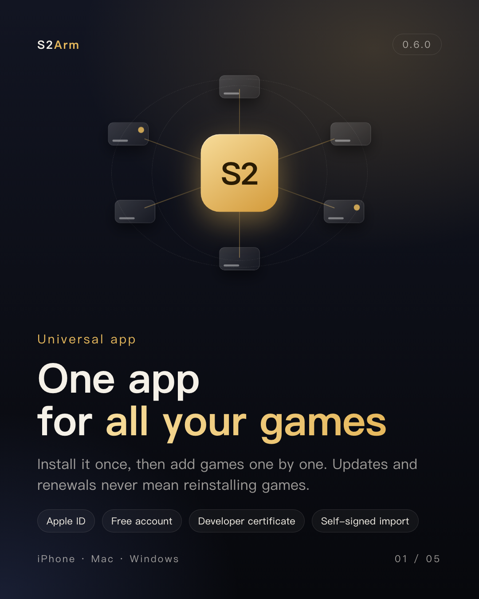
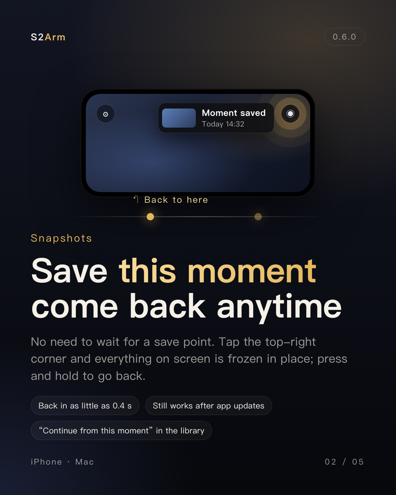

<p align="center"><a href="https://s2arm.com"></a><br><a href="https://s2arm.com">s2arm.com</a></p>

<p align="center">[简体中文](README.zh-CN.md) · [繁體中文](README.zh-TW.md) · [English](README.md) · [日本語](README.ja.md) · [Español](README.es.md) · [Français](README.fr.md)</p>

> [!NOTE]
> **[s2arm.com](https://s2arm.com) est le site officiel de S2Arm.** S2Arm est gratuit et open source, et n'accepte jamais aucun don ; procurez-vous S2Arm uniquement sur [s2arm.com](https://s2arm.com) ou dans ce dépôt GitHub.

**Vos propres jeux Switch, en natif sur iPhone, iPad et Mac.** Le code du jeu est réécrit en ARM64 natif et s'exécute directement sur le processeur de l'appareil ; les graphismes passent directement par Metal. Depuis la 0.6.0, il n'y a qu'une seule App S2Arm sur le téléphone et tous les jeux sont dans sa bibliothèque : dans le lanceur Mac ou Windows, envoyez les jeux un par un avec « Envoyer sur l'iPhone » et jouez.

Plateformes : iPhone / iPad (iOS / iPadOS 18 et plus) · Mac (puce Apple, macOS 15 et plus) · Lanceur Mac ou Windows · Licence : Apache-2.0 · **Jeux à fournir vous-même**

[Télécharger le lanceur](https://s2arm.com) · [Toutes les versions](https://github.com/jhaizhou-ops/S2Arm/releases) · [Preuves](docs/validation/EVIDENCE.md)

<p align="center"></p>

## Nouveautés de la 0.6.0

### Une seule App pour tous vos jeux

Installez S2Arm une seule fois sur le téléphone, puis ajoutez les jeux un par un. Mettre à jour S2Arm ou renouveler sa signature ne demande jamais de réinstaller les jeux, et les sauvegardes restent là. Vous pouvez signer avec un identifiant Apple gratuit ou payant, ou avec un certificat de développeur, ou bien signer vous-même puis importer.

### Instantanés : enregistrez cet instant, revenez quand vous voulez

Pas besoin d'attendre le point de sauvegarde du jeu. En jeu, touchez le ◉ en haut à droite et l'instant présent est enregistré ; maintenez-le appuyé et choisissez « Revenir à l’instant sauvegardé » pour y revenir. La prochaine fois que vous ouvrez la bibliothèque, touchez « Reprendre à cet instant », tout en haut, pour y entrer directement.

- Chaque jeu ne garde que l'instantané le plus récent ; le nouveau remplace l'ancien.
- Un instantané occupe de l'espace sur le téléphone (la taille dépend du jeu). Maintenez appuyé pour le supprimer et libérer l'espace ; vous pouvez aussi les désactiver dans les Réglages.
- Un instantané ne fonctionne que sur l'appareil qui l'a enregistré ; il fonctionne toujours après une mise à jour de S2Arm.

<p align="center"></p>

### Un fichier pour continuer sur un autre appareil

Chaque jeu peut être exporté en fichier .s2arm ; importez-le sur un autre de vos appareils pour jouer, le téléphone le signe tout seul. Un jeu n'occupe qu'une seule copie, et « Libérer de l'espace » montre d'un coup d'œil ce que prennent le jeu, les sauvegardes et les instantanés.

### Tous les shaders prêts : fluide dès la première partie

Les shaders dont le jeu a besoin sont préparés au moment de l'envoi, donc la première entrée dans une nouvelle zone ne saccade plus. Les diagnostics des joueurs ont rassemblé **26 809** shaders de 69 jeux dont la compilation échouait sur l'appareil. Hors 278 entrées endommagées, illisibles en tant que shaders, **les 26 531** autres compilent désormais tous.

Comment c’est compté : ce taux ne porte que sur les shaders qui **avaient échoué à la compilation** dans les diagnostics des joueurs ; ce n’est pas un taux de couverture de tous les shaders. Sur les 98 restants, 91 n’étaient pas des shaders mais de la mémoire mal lue lors de la capture (capture corrigée), et les 7 autres ont été corrigés à la racine.

Remarque : sur iPhone, les pipelines précompilés ne sont générés que lorsque vous envoyez le jeu avec cet iPhone connecté. Lors d’un export pour signer soi-même (sans iPhone connecté) ou avec plusieurs iPhone connectés, cette version les compile encore la première fois qu’ils sont nécessaires, comme en 0.5. Ce sera amélioré dans une prochaine version.

### Corrections, performances et graphismes

De la 0.5.0 à la 0.6.0 (la façon de compter chaque chiffre est dans le tableau) :

| | Chiffre | Comment c'est compté |
|---|---|---|
| Corrections intégrées | **344** | Commits de correction intégrés dans main après la 0.5.0 |
| Retours de joueurs traités | **156** | Issues de retours fermées après la 0.5.0 |
| Contributions de la communauté | **126** | Pull requests de joueurs et de développeurs |
| Temps de rendu GPU | **−50%** | Scène en éclairage différé, 4.8–5.9 ms → 2.7 ms |
| Pic de mémoire à l'export | **−35%** | Pic de mémoire lors de l'export de gros jeux |

Et aussi : plusieurs types de problèmes de shaders corrigés à la racine, chargements et sauvegardes plus fiables, interpolation d'images plus fluide, et installation de l'App, signature et envoi plus stables sur Windows et Mac. Merci à chaque joueur qui nous a signalé un problème.

## Pour commencer

1. Téléchargez le lanceur Mac ou Windows sur [s2arm.com](https://s2arm.com) et ouvrez-le.
2. Importez vos propres clés et vos jeux ; mettez le jeu de base, les mises à jour et les DLC dans un même dossier et importez-les en une fois.
3. Branchez l'iPhone, cliquez sur « Installer S2Arm » dans la vignette « S2Arm », la première de la bibliothèque du lanceur, connectez-vous et signez avec votre identifiant Apple : S2Arm s'installe sur le téléphone.
4. Choisissez un jeu et cliquez sur « Envoyer sur l'iPhone ».
5. Ouvrez S2Arm sur le téléphone et choisissez un jeu dans la bibliothèque.

Vous pouvez aussi jouer directement sur le Mac : choisissez « Ce Mac ». Sans brancher le téléphone, vous pouvez exporter un fichier .s2arm et le mettre sur le téléphone avec AirDrop ou l'App Fichiers pour l'importer.

### Signer soi-même avec AltStore / SideStore

Importez des jeux directement sur le téléphone, sans vous connecter à votre identifiant Apple sur un ordinateur ni créer de nouveau certificat :

1. Dans les réglages d’AltStore ou de SideStore, exportez votre certificat de signature et choisissez un mot de passe.
2. Ouvrez S2Arm : roue dentée → Certificat de signature → Importer un .p12…, choisissez le certificat et saisissez le mot de passe.
3. Placez ensuite les fichiers .s2arm et .img (exportés depuis votre ordinateur ou partagés par un ami) dans le dossier Import Here de S2Arm, et jouez.

Attention : gérez chaque identifiant Apple depuis AltServer sur un seul ordinateur. Avec deux, chacun annule les certificats de l’autre et AltStore affiche « Multiple AltServers ». Avant la fin des 7 jours, il suffit de toucher Refresh All dans AltStore ; rien d’autre à faire dans S2Arm.

### Mettre à niveau depuis la 0.5

Les jeux, sauvegardes et données de jeu déjà présents sur votre téléphone restent tous là. Pas besoin de réexporter ni de renvoyer les données de jeu.

1. Sur Mac, connectez-vous une fois avec votre identifiant Apple dans S2Arm (la 0.5 utilisait le compte connecté dans Xcode ; la 0.6.0 se connecte directement dans S2Arm. Les joueurs Windows n'ont pas cette étape à faire).
2. Branchez le téléphone et cliquez sur « Mettre à jour S2Arm » dans la vignette « S2Arm », la première de la bibliothèque : les sauvegardes de chaque jeu sont d'abord copiées sur l'ordinateur, puis la nouvelle App remplace l'ancienne. Avec le même identifiant Apple, elle s'installe par-dessus.
3. Juste après, la même page indique combien d'anciens jeux du téléphone doivent être mis à jour une fois pour être jouables ; ils sont tous cochés, cliquez sur « Mettre à jour ces N jeux » (ou plus tard, cochez dans le tableau de bord les jeux marqués « Mise à jour conseillée » et cliquez sur « Mettre à jour la sélection »). Jeu par jeu, les sauvegardes reviennent sur l'ordinateur, le nouveau programme est envoyé et seules les ressources modifiées sont transférées ; chaque jeu prend environ 1 à 2 minutes. Pour les jeux dont la bibliothèque de shaders a été faite par l'ancienne version, l'ordinateur la refait avec la nouvelle à cette étape (les fichiers du jeu ou sa version Mac doivent encore être dans votre bibliothèque) ; la première fois prend de quelques minutes à quelques dizaines de minutes. Inutile de lancer l'optimisation de rang S. Sur un PC Windows sans les outils de développement Metal, cette étape envoie l'ancienne bibliothèque et indique pourquoi ; le jeu fonctionne quand même, et une fois les outils installés dans « Préparer ce PC », renvoyez-le pour avoir la nouvelle bibliothèque.

Tant que l'étape 3 n'est pas faite, ces jeux s'affichent sur le téléphone avec « À mettre à jour une fois sur l'ordinateur » et ne s'ouvrent pas, mais ils ne sont pas perdus. Les jeux installés depuis un autre ordinateur apparaissent sur une ligne à part de la même page ; mettez-les à jour sur cet ordinateur. Si vous avez supprimé le pack de ressources iPhone d'un jeu avec « Libérer de l'espace », refaites le paquet iPhone de ce jeu.

Si vous signez vous-même avec AltStore ou un outil semblable : connectez l’iPhone, cliquez sur « Installer S2Arm » dans la vignette « S2Arm » (la première de la bibliothèque) et, sur la page indiquant que vous n’êtes pas connecté avec un identifiant Apple, cliquez sur « Exporter pour l’auto-signature à la place (sans iPhone) » pour obtenir le nouveau S2Arm.ipa ; installez-le par-dessus l’ancien avec AltStore ; importez votre certificat de signature (SideStore : roue dentée → Certificat de signature → Récupérer depuis SideStore dans S2Arm ; AltStore : exportez-le dans ses réglages, puis Importer un .p12…) ; enfin cliquez sur « Envoyer la sélection sur l’iPhone » dans la console, ou sur « Exporter pour signer soi-même » pour chaque jeu et placez son .s2arm et son .img dans Import Here.

## Une IA peut piloter

Les lanceurs Mac et Windows proposent tous deux une interface de contrôle, `s2armctl` : un assistant IA peut importer des jeux, exporter, installer, suivre la progression et lire les erreurs, et chaque étape est visible dans la fenêtre du lanceur. La boîte à outils d'autodiagnostic, d'autoréparation et de retour qui l'accompagne permet à l'IA de localiser elle-même un problème, de le corriger selon la marche à suivre et, si elle n'y arrive pas, de préparer un paquet de diagnostic que vous n'aurez plus qu'à envoyer. Voyez le compte rendu complet d'une IA qui diagnostique et corrige un vrai problème : [Preuves](docs/validation/EVIDENCE.md#ai-at-the-wheel)

### Laisser une IA le faire pour vous

Envoyez ceci à votre assistant IA (il doit pouvoir exécuter des commandes sur votre ordinateur) :

> Lis https://github.com/jhaizhou-ops/S2Arm/blob/main/launchers/macos/skill/s2arm-operator/SKILL.md , puis aide-moi à installer mon jeu Switch sur mon iPhone.

Il avancera pas à pas avec ces commandes, et vous verrez chaque étape dans la fenêtre du lanceur :

```bash
/Applications/S2Arm.app/Contents/Resources/s2armctl start        # ouvre le lanceur et s'y connecte
/Applications/S2Arm.app/Contents/Resources/s2armctl next         # quoi faire maintenant, qui le fait, et pourquoi
/Applications/S2Arm.app/Contents/Resources/s2armctl diag export ~/Desktop/S2Arm-diagnostics.zip   # exporte un paquet de diagnostic s'il n'arrive pas à corriger
```

Pour ce que vous seul pouvez faire (autorisations du système, connexion avec votre identifiant Apple, toucher « Se fier » sur le téléphone), l'IA s'arrête et vous le dit. Sous Windows, utilisez `s2armctl.cmd` dans le dossier du lanceur, avec les mêmes commandes. Windows ne produit que des paquets iPhone / iPad ; pour un problème en jeu, signalez-le depuis le téléphone : touchez le bouton de signalement à droite de la roue dentée, en haut à gauche en jeu, et indiquez quel jeu, ce que vous avez fait et ce que vous avez vu. Le diagnostic est envoyé avec le signalement.

**Un problème en jeu** (graphismes, fréquence d'images, saccades, plantages) ? Envoyez ceci à l'IA :

> Lis https://github.com/jhaizhou-ops/S2Arm/blob/main/skills/player-game-triage/SKILL.md . Le jeu auquel je joue dans S2Arm a ce problème : <décris ce qui se passe>. Vérifie d'abord les réglages et récupère le diagnostic ; si tu peux modifier le code, corrige à la racine avec la méthode décrite et ouvre une PR, sinon aide-moi à rédiger une Issue.

## Éprouvé à grande échelle sur de vrais appareils

**211** jeux passés en revue, avec **95%** de réussite à l'export du premier coup. **4700+** sessions de test sur de vrais appareils iOS et **1000+** sur macOS. [Preuves](docs/validation/EVIDENCE.md#tested-at-scale)

## Rapide, fluide et économe

Sur un MacBook Air (M3) avec 16 GB de mémoire, de l'import du jeu jusqu'au paquet iPhone terminé, entièrement à froid :

| Jeu | Fichiers d'origine | Shaders | Durée d'export |
|---|---|---|---|
| Un action-RPG de 23.5 GB | 23.5 GB | 1,222 | **6.4 min** |
| Un jeu de simulation de vie de 12.0 GB | 12.0 GB | 9,315 | **8.6 min** |
| Un jeu en monde ouvert de 17.5 GB | 17.5 GB | 26,999 | **34 min** |

Un jeu Switch 2 mesuré sur un vrai iPhone 17 Pro Max : **60 fps constants** tant que le téléphone n'a pas chauffé, **37–43 fps** une fois chaud après une forte charge prolongée, pour environ **0.15 joule par image**. [Preuves](docs/validation/EVIDENCE.md#speed-and-efficiency)

## Couverture

| Plateforme | Prise en charge |
|---|---|
| iPhone / iPad | iOS / iPadOS 18 et plus ; tous les jeux dans une seule App S2Arm |
| Mac | Puce Apple, macOS 15 et plus ; le lanceur installe l'App et envoie les jeux, et vous pouvez aussi jouer directement sur le Mac |
| Windows | Lanceur graphique : installer l'App, envoyer des jeux, exporter en .s2arm |

[Preuves](docs/validation/EVIDENCE.md#platforms)

## Portages avancés en aval

Certains jeux ont un portage avancé réalisé spécialement par la communauté. S2Arm reconnaît ces jeux : à l'export, une page d'explication s'affiche, et vous pouvez passer à la méthode du projet en aval (l'import, l'export et l'installation restent des boutons dans S2Arm, avec l'implémentation du projet en aval en dessous) ou garder la méthode standard. Le registre est dans [`pack/downstream/schemes.json`](pack/downstream/schemes.json) ; l'accord entre les deux est celui que décrit la documentation du projet en aval.

| Méthode | Projet | Appareils | Accord |
|---|---|---|---|
| D2R-Mobile | [jhaizhou-ops/d2r-mobile](https://github.com/jhaizhou-ops/d2r-mobile) | iPhone / iPad (iOS 26 et plus ; Android et HarmonyOS en cours d'intégration) | [docs/S2ARM.md](https://github.com/jhaizhou-ops/d2r-mobile/blob/main/docs/S2ARM.md) |

## Limites, en toute franchise

S2Arm exécute des jeux 64 bits (AArch64). Les puces Apple ne peuvent pas exécuter de code ARM 32 bits, donc les jeux 32 bits ne sont pas pris en charge, pas plus que les jeux qui ont besoin d'un espace d'adressage de 36 bits.

## Participer au développement

[Guide de contribution](CONTRIBUTING.md) · [Règles de collaboration avec l'IA](LLM_POLICY.md) · [Skills de diagnostic et de correction à la racine pour l'IA](skills/) · [Signaler un problème](https://github.com/jhaizhou-ops/S2Arm/issues) · [Licences tierces](THIRD_PARTY_LICENSES.md)

## Remerciements

S2Arm se tient sur les épaules de sa communauté.

- **Codéveloppeurs** : merci à toutes celles et ceux qui ont ouvert une PR ou une Issue dans ce projet ; votre code, vos tests sur de vrais appareils et vos rapports de bugs ont façonné le S2Arm d'aujourd'hui (par ordre de première contribution) : [@biglawine](https://github.com/biglawine), [@yyan160](https://github.com/yyan160), [@DanielZhangyc](https://github.com/DanielZhangyc), [@vickwv](https://github.com/vickwv), [@Xc1Ym](https://github.com/Xc1Ym), [@fjack](https://github.com/fjack), [@ha7rock](https://github.com/ha7rock), [@yourmoonlight](https://github.com/yourmoonlight), [@qidian99](https://github.com/qidian99), [@n06ody](https://github.com/n06ody), [@YTwsy](https://github.com/YTwsy), [@wdjwxh](https://github.com/wdjwxh), [@realskyrin](https://github.com/realskyrin), [@wwmogu](https://github.com/wwmogu), [@quancunlau](https://github.com/quancunlau), [@moongrant](https://github.com/moongrant), [@imyinyx](https://github.com/imyinyx), [@s-leeq](https://github.com/s-leeq), [@Zhangbu](https://github.com/Zhangbu), [@retX0](https://github.com/retX0), [@zh0ngtian](https://github.com/zh0ngtian), [@fengbird](https://github.com/fengbird), [@zsakvo](https://github.com/zsakvo), [@1500256797](https://github.com/1500256797), [@BossaMelon](https://github.com/BossaMelon), [@GayoZhao](https://github.com/GayoZhao), [@sovaly](https://github.com/sovaly), [@ruterfu](https://github.com/ruterfu), [@fyn1320068837-source](https://github.com/fyn1320068837-source), [@InTheManXG](https://github.com/InTheManXG), [@neexuan](https://github.com/neexuan), [@Catnip202X](https://github.com/Catnip202X), [@kmmao](https://github.com/kmmao), [@Darcelsan](https://github.com/Darcelsan), [@lson-lee](https://github.com/lson-lee), [@cszwdy](https://github.com/cszwdy), [@Aoldbald](https://github.com/Aoldbald), [@potpot3](https://github.com/potpot3), [@yangxiaofei819](https://github.com/yangxiaofei819), [@nevenhsu](https://github.com/nevenhsu), [@shuangwei-Ye](https://github.com/shuangwei-Ye), [@IUMonster](https://github.com/IUMonster), [@zhanggh126](https://github.com/zhanggh126), [@xiaoweili126](https://github.com/xiaoweili126), [@shenxianmq](https://github.com/shenxianmq), [@rugal7699](https://github.com/rugal7699), [@painkiller2049](https://github.com/painkiller2049), [@tommy762](https://github.com/tommy762), [@tiannip](https://github.com/tiannip), [@Tiaoge-tou](https://github.com/Tiaoge-tou), [@skyezhangF](https://github.com/skyezhangF), [@DDDDEEP](https://github.com/DDDDEEP), [@CJohnSnow](https://github.com/CJohnSnow), [@shanaiardor](https://github.com/shanaiardor), [@wehnes](https://github.com/wehnes), [@SantaJiang](https://github.com/SantaJiang), [@orzdesu](https://github.com/orzdesu), [@shengyifan](https://github.com/shengyifan), [@QBYLHQ](https://github.com/QBYLHQ), [@kurtzou1](https://github.com/kurtzou1), [@TravelC](https://github.com/TravelC), [@f\*\*\*\*\*\*\*](https://github.com/fucknima), [@mizukico](https://github.com/mizukico), [@turtle4512](https://github.com/turtle4512), [@CrazyBunQnQ](https://github.com/CrazyBunQnQ), [@lwjailjq-spec](https://github.com/lwjailjq-spec), [@hkk818](https://github.com/hkk818), [@AirEcho825](https://github.com/AirEcho825), [@asdaffeqqr](https://github.com/asdaffeqqr), [@jazz-zzzz](https://github.com/jazz-zzzz), [@Canon329](https://github.com/Canon329), [@llpgf](https://github.com/llpgf), [@wyx813562408](https://github.com/wyx813562408), [@GirlNet](https://github.com/GirlNet), [@yangliguo7](https://github.com/yangliguo7), [@vuongtqchip](https://github.com/vuongtqchip), [@danielmx98](https://github.com/danielmx98), [@vpromise](https://github.com/vpromise), [@starlighteryuan-rgb](https://github.com/starlighteryuan-rgb), [@Jean-Zhang999](https://github.com/Jean-Zhang999), [@devinhurry](https://github.com/devinhurry), [@zhaobenshan-cmd](https://github.com/zhaobenshan-cmd), [@ethan-unplugged](https://github.com/ethan-unplugged), [@huanhuxilu](https://github.com/huanhuxilu), [@Y2JING](https://github.com/Y2JING), [@lin465](https://github.com/lin465), [@ZEERDEER](https://github.com/ZEERDEER), [@Haseenesss](https://github.com/Haseenesss), [@xavierskip](https://github.com/xavierskip), [@Levier007](https://github.com/Levier007), [@XuanLIN0224](https://github.com/XuanLIN0224), [@kaiying1994](https://github.com/kaiying1994), [@zhaozhen197](https://github.com/zhaozhen197), [@igobypc](https://github.com/igobypc), [@nimohe](https://github.com/nimohe), [@Glaucus-Kwok](https://github.com/Glaucus-Kwok), [@1614912120](https://github.com/1614912120), [@sofaseakk](https://github.com/sofaseakk), [@Eylock](https://github.com/Eylock), [@tututuhehehe](https://github.com/tututuhehehe), [@dovelflab](https://github.com/dovelflab), [@daiadong](https://github.com/daiadong), [@l1uvu](https://github.com/l1uvu), [@torg20](https://github.com/torg20), [@2k002](https://github.com/2k002), [@rzhang-tech](https://github.com/rzhang-tech), [@edwardzgy](https://github.com/edwardzgy), [@sevenspan](https://github.com/sevenspan), [@unionpacificy](https://github.com/unionpacificy), [@wendaocode](https://github.com/wendaocode), [@zhegemimahaolihai666](https://github.com/zhegemimahaolihai666), [@rhotov](https://github.com/rhotov), [@Arvinnma](https://github.com/Arvinnma), [@abissa](https://github.com/abissa), [@ckuffff](https://github.com/ckuffff), [@xiaopebaka](https://github.com/xiaopebaka), [@xiaoxiaocos](https://github.com/xiaoxiaocos), [@BTFKM](https://github.com/BTFKM), [@UKhhh](https://github.com/UKhhh), [@bagasromadon](https://github.com/bagasromadon), [@wangkoukouX](https://github.com/wangkoukouX), [@Klien-m](https://github.com/Klien-m), [@hycailxy](https://github.com/hycailxy), [@CCCGoat](https://github.com/CCCGoat), [@NJimmi](https://github.com/NJimmi), [@qooxxp](https://github.com/qooxxp), [@lhailiang20-hue](https://github.com/lhailiang20-hue), [@lucaAce1024](https://github.com/lucaAce1024), [@dejavuwl](https://github.com/dejavuwl), [@KANATA23333](https://github.com/KANATA23333), [@wowkiseki](https://github.com/wowkiseki), [@wcashew](https://github.com/wcashew), [@Chidober](https://github.com/Chidober), [@Orreroem](https://github.com/Orreroem), [@XIAMI2016](https://github.com/XIAMI2016), [@StrayDogA8](https://github.com/StrayDogA8), [@HFYKratos](https://github.com/HFYKratos), [@iriotssos](https://github.com/iriotssos), [@oneincase](https://github.com/oneincase), [@hx23840](https://github.com/hx23840).
- **Manette virtuelle et menu de la roue dentée** : le menu de la roue dentée en jeu et l'édition sur place de la manette virtuelle sur iOS reprennent le design façon MeloNX que [@neexuan](https://github.com/neexuan) a apporté dans [#134](https://github.com/jhaizhou-ops/S2Arm/pull/134) ; S2Arm l'a réimplémenté entièrement. Merci à MeloNX d'avoir exploré cette interaction sur iOS.
- **Ryujinx** (Ryujinx Team and Contributors, MIT) : projet amont des services système et de la traduction des shaders ; la couche de compatibilité de S2Arm est construite dessus.
- **[NX2Apple](https://github.com/LNPANDY/NX2Apple)** (LNPANDY, MIT) : projet amont de l'interface du lanceur.
- **[nxnative](https://github.com/seedds/nxnative)** (seedds, MIT, Copyright (c) 2026 seedds) : l'œuvre originale de la couche graphique directe ; la couche par laquelle S2Arm relie directement les graphismes du jeu à Metal vient de ce travail. Sans cette publication open source généreuse, la voie directe d'aujourd'hui n'existerait pas. Son fork **[kartnative](https://github.com/pahorema/kartnative)** (MIT) est à l'origine du partage des pages du tas par blocs pour les grandes textures creuses.
- **[d2r-mobile](https://github.com/jhaizhou-ops/d2r-mobile)** (MIT) : a ouvert cette voie technique en amenant pour la première fois son propre jeu Switch en natif sur iPhone, iPad, Mac, Android et HarmonyOS.
- **Impactor** (Samara M, MIT) et **apple-codesign** (MPL-2.0) : signature et installation depuis Windows.
- **LNPANDY** ainsi que les auteurs originaux et contributeurs du shell de bibliothèque iOS : le shell et son sous-système d'archives RomFS.
- **ns2pro-bridge** (DanielZhangyc, MIT), **MacNativeGames** (MIT), **LumaDock** (MIT), **deko3d** (fincs, zlib), **nvn.h** (h1k421, MIT), **bcdec** (Sergii Kudlai, MIT / Unlicense), **SPIRV-Cross** et **Vulkan-Headers** (The Khronos Group), **SMAA** (Jorge Jimenez et al., MIT), le tessellateur de **Mesa** (Microsoft, MIT), **Capstone**, **LZ4**, **.NET**, **libvpx**, **libopus**, **dav1d** et les polices **Noto**.

Les versions, les textes complets des licences et le rôle de chaque composant figurent dans [NOTICE](NOTICE) et dans la [liste des licences tierces](THIRD_PARTY_LICENSES.md).

## Évolution des étoiles

<a href="https://star-history.com/#jhaizhou-ops/S2Arm&Date"><picture><source media="(prefers-color-scheme: dark)" srcset="https://api.star-history.com/svg?repos=jhaizhou-ops/S2Arm&type=Date&theme=dark" /></picture></a>

## Licence et mentions légales

S2Arm est open source sous [Apache License 2.0](LICENSE). Le projet ne fournit aucun jeu ni aucune clé ; procurez-vous légalement vos fichiers de jeu. S2Arm n'est ni affilié à Nintendo ni autorisé par Nintendo ; les noms de jeux et les marques appartiennent à leurs détenteurs respectifs.
