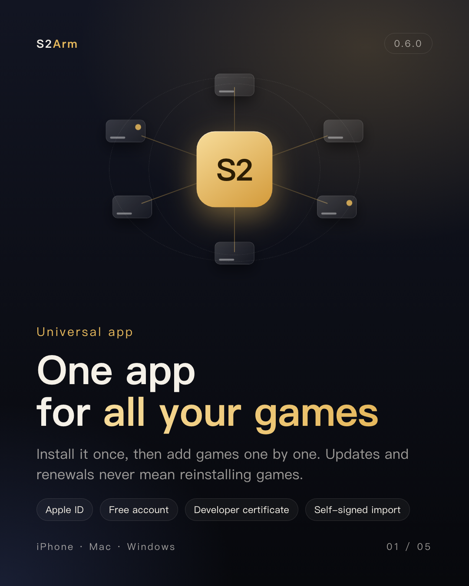
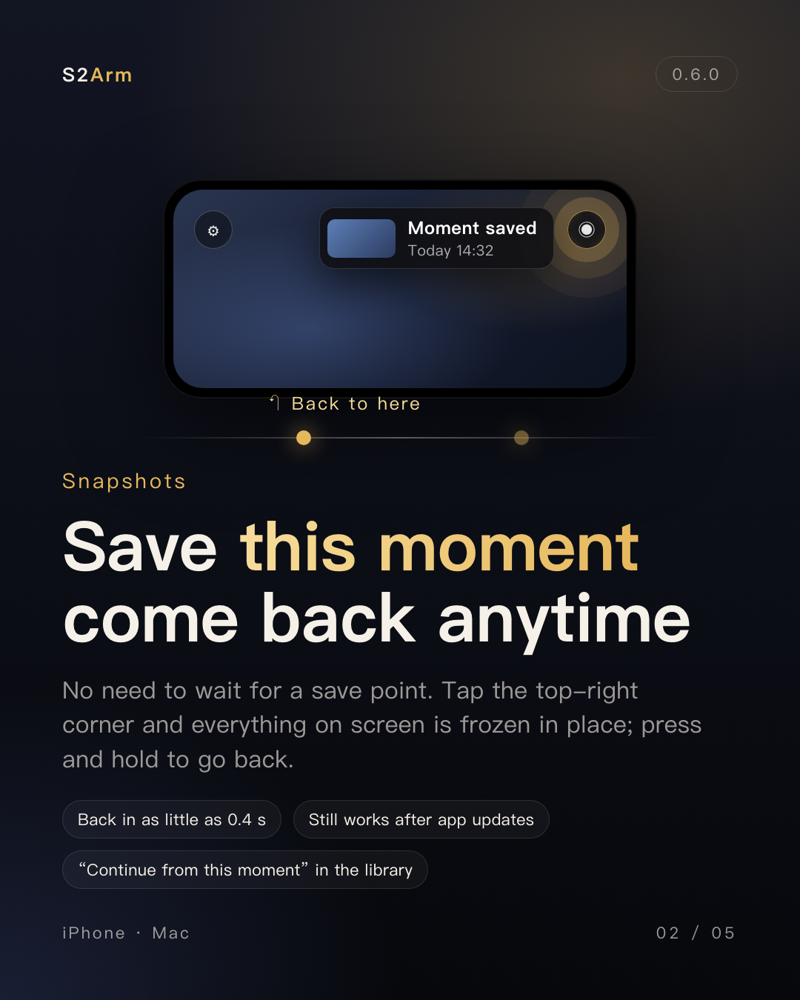

<p align="center"><a href="https://s2arm.com"></a><br><a href="https://s2arm.com">s2arm.com</a></p>

<p align="center">[简体中文](README.zh-CN.md) · [繁體中文](README.zh-TW.md) · [English](README.md) · [日本語](README.ja.md) · [Español](README.es.md) · [Français](README.fr.md)</p>

> [!NOTE]
> **[s2arm.com](https://s2arm.com) は S2Arm の公式サイトです。** S2Arm は無料のオープンソースで、寄付は一切受け付けていません。S2Arm は [s2arm.com](https://s2arm.com) またはこの GitHub リポジトリからのみ入手してください。

**あなた自身の Switch ゲームを、iPhone・iPad・Mac でネイティブに。** ゲームのコードはネイティブの ARM64 に書き換えられ、デバイスのプロセッサで直接動きます。グラフィックスは Metal に直結します。0.6.0 からは、スマホに入れる S2Arm App はひとつだけで、すべてのゲームはそのライブラリに入ります。Mac または Windows のランチャーでゲームを 1 本ずつ「iPhone に送る」だけで遊べます。

対応環境：iPhone / iPad（iOS / iPadOS 18 以降）· Mac（Apple シリコン、macOS 15 以降）· Mac または Windows のランチャー · ライセンス：Apache-2.0 · **ゲームは各自でご用意ください**

[ランチャーをダウンロード](https://s2arm.com) · [すべてのリリース](https://github.com/jhaizhou-ops/S2Arm/releases) · [検証資料](docs/validation/EVIDENCE.md)

<p align="center"></p>

## 0.6.0 の新機能

### ひとつの App に、すべてのゲーム

スマホに S2Arm を一度入れたら、あとはゲームを 1 本ずつ送るだけ。S2Arm を更新しても再署名しても、ゲームを入れ直す必要はなく、セーブデータもそのまま残ります。署名には無料または有料の Apple ID、開発者証明書が使えます。自分で署名してから読み込むこともできます。

### スナップショット：この瞬間を保存して、いつでも戻る

ゲーム側のセーブポイントを待つ必要はありません。ゲーム中に右上の ◉ を軽くタップすると、その瞬間が保存されます。長押しして「保存した瞬間に戻る」を選ぶと戻れます。次にライブラリを開いたら、いちばん上の「この瞬間から続ける」をタップするだけでそのまま再開できます。

- 各ゲームに残るのは最新の 1 つだけで、新しく保存すると古いものは上書きされます。
- スナップショットはスマホの容量を使います（サイズはゲームによって異なります）。長押しで削除して容量を空けられます。設定でオフにすることもできます。
- スナップショットは保存したデバイスでのみ使えます。S2Arm を更新した後も戻れます。

<p align="center"></p>

### ファイルひとつで、別のデバイスでも続きを

どのゲームも .s2arm ファイルとして書き出せます。手持ちの別のデバイスで読み込めば遊べて、署名はスマホが自分で済ませます。1 本のゲームが使う容量は 1 つ分だけ。ゲーム・セーブデータ・スナップショットがそれぞれどれだけ使っているかは「容量を解放」でひと目でわかります。

### シェーダーを全部用意：初回からなめらか

ゲームを送るときに、そのゲームが使うシェーダーを用意しておくので、新しい場面に初めて入ったときに一瞬止まることがなくなります。プレイヤーの診断から、69 本のゲームで端末上のコンパイルに失敗したシェーダーを **26,809** 個集めました。壊れていてシェーダーとして読めない 278 個を除く **26,531** 個が、**すべて**コンパイルできるようになりました。

数え方：この割合はプレイヤーの診断で**過去にコンパイルに失敗した**シェーダーだけを対象にしたもので、すべてのシェーダーのカバー率ではありません。残りの 98 個のうち 91 個は取得時にメモリを読み違えたもので、そもそもシェーダーではありませんでした（取得は修正済み）。残る 7 個は根本修正済みです。

注意：iPhone 向けの事前コンパイル済みパイプラインは、パソコンにその iPhone をつないで「iPhone に送る」ときにだけ作られます。自己署名用に書き出す場合（iPhone をつながない）や複数の iPhone を同時につないでいる場合、このバージョンでは 0.5 と同じく初めて必要になったときにコンパイルします。今後のバージョンで改善します。

### 修正・パフォーマンス・画面

0.5.0 から 0.6.0 まで（数え方は表のとおり）：

| | 数 | 数え方 |
|---|---|---|
| 取り込んだ修正 | **344** 件 | 0.5.0 リリース後に main に取り込んだ修正コミット |
| 対応したプレイヤー報告 | **156** 件 | 0.5.0 リリース後にクローズしたフィードバック issue |
| 取り込んだコミュニティ貢献 | **126** 件 | プレイヤーと開発者からの PR |
| GPU 描画時間 | **−50%** | ディファードライティングの場面、4.8–5.9 ms → 2.7 ms |
| エクスポート時のメモリ最大値 | **−35%** | 大型ゲームをエクスポートするときのメモリ最大値 |

ほかにも、シェーダーの問題を何種類も根本から修正し、ロードとセーブがより確実になり、フレーム補間がよりなめらかになり、Windows と Mac での App のインストール・署名・送信がより安定しました。問題を報告してくださったすべてのプレイヤーに感謝します。

## はじめかた

1. [s2arm.com](https://s2arm.com) から Mac または Windows のランチャーをダウンロードして開きます。
2. 自分のキーとゲームを読み込みます。本体・アップデート・DLC は同じフォルダに入れて、まとめて読み込みます。
3. iPhone をつなぎ、ランチャーのライブラリ先頭にある「S2Arm」タイルの「S2Arm をインストール」をクリックし、Apple ID でサインインして署名すると、S2Arm がスマホに入ります。
4. ゲームを選んで「iPhone に送る」をクリックします。
5. スマホで S2Arm を開き、ライブラリからゲームを選んで遊びます。

Mac で直接遊ぶこともできます。「この Mac」を選ぶだけです。スマホをつながない場合は、.s2arm ファイルを書き出し、AirDrop か「ファイル」App でスマホに入れて読み込めます。

### AltStore / SideStore で自己署名する場合

パソコンで Apple ID にサインインしなくても、新しい証明書を作らなくても、スマホだけでゲームを読み込めます：

1. AltStore または SideStore の設定で署名証明書を書き出し、パスワードを設定します。
2. S2Arm を開き、歯車 →「署名証明書」→「.p12 を読み込む…」で、その証明書を選んでパスワードを入力します。
3. あとはパソコンで書き出した、または友だちから受け取った .s2arm と .img を S2Arm の「Import Here」フォルダに入れれば遊べます。

注意：1 つの Apple ID は 1 台のパソコンの AltServer だけで管理してください。2 台で使うと互いの証明書が無効になり、AltStore に「Multiple AltServers」と表示されます。7 日の期限が来る前に AltStore で「Refresh All」をタップするだけで、S2Arm 側の操作は不要です。

### 0.5 からのアップグレード

スマホにあるゲーム・セーブデータ・ゲームデータはすべて残ります。エクスポートし直す必要も、ゲームデータを送り直す必要もありません。

1. Mac のプレイヤーは、まず S2Arm で Apple ID に一度サインインします（0.5 は Xcode のアカウントを使っていましたが、0.6.0 では S2Arm の中で直接サインインします。Windows のプレイヤーはこの手順は不要です）。
2. スマホをつなぎ、ライブラリ先頭にある「S2Arm」タイルの「S2Arm を更新」をクリックします。まず各ゲームのセーブデータをパソコンにバックアップしてから、新しい App に入れ替えます。同じ Apple ID なら上書きインストールになります。
3. インストールが終わると、同じ画面に「このスマホには一度更新が必要な旧ゲームが N 本あります」と表示され、すべてチェック済みなので「この N 本を更新」をクリックします（後からダッシュボードで「更新をおすすめ」の付いたゲームを選んで「選択を更新」でも構いません）。1 本ずつ順番に、セーブデータをパソコンに戻し、新しいプログラムを送り、変わったリソースだけを送ります。1 本あたり約 1〜2 分です。シェーダーライブラリが旧バージョンで作られたゲームは、この手順でパソコンが新バージョンで作り直します（ライブラリにそのゲームのゲームファイルか Mac 版が残っている必要があります）。初回は数分から数十分かかります。S 級最適化を押す必要はありません。Metal 開発ツールが入っていない Windows PC では、この手順で古いライブラリをそのまま送り、理由を表示します。ゲームは普通に遊べます。「この PC を準備」でツールを入れてからもう一度送ると、新しいライブラリになります。

手順 3 が終わるまで、これらのゲームはスマホで「パソコンで一度更新」と表示されて開けませんが、消えたわけではありません。別のパソコンからインストールしたゲームは同じ画面に別の行で表示されるので、そのパソコンで更新してください。「容量を解放」で iPhone のリソースパックを削除したゲームは、そのゲームの iPhone パッケージを作り直してください。

AltStore などで自分で署名しているプレイヤーは、iPhone をつないでライブラリ先頭の「S2Arm」タイルで「S2Arm をインストール」をクリックし、Apple ID にサインインしていないと表示されたページで「代わりに自己署名用に書き出す（iPhone 不要）」をクリックして新しい S2Arm.ipa を書き出し、AltStore で古いものの上からインストールします。次に署名証明書を読み込みます（SideStore は S2Arm の歯車 →「署名証明書」→「SideStore から取得」、AltStore は設定で証明書を書き出してから「.p12 を読み込む…」）。最後にコンソールで「選んだゲームを iPhone に送る」をクリックするか、各ゲームの「自己署名用に書き出す」で .s2arm と .img を「Import Here」に入れてください。

## AI がそのまま操作できる

Mac と Windows のランチャーはどちらも操作用インターフェース `s2armctl` を公開しています。AI アシスタントはゲームの読み込み、エクスポート、インストール、進行状況の確認、エラーの読み取りができ、どの手順もランチャーのウィンドウで見えます。付属の自己チェック・自己修復・フィードバック用ツールキットで、AI は自分で問題を突き止め、手順書どおりに修正し、直せなければ診断パッケージにまとめてあなたに提出を任せます。AI が実際の問題を診断して直すまでの全記録はこちら：[検証資料](docs/validation/EVIDENCE.md#ai-at-the-wheel)

### AI に操作を任せる

次の文を AI アシスタントに送ってください（あなたのパソコンでコマンドを実行できる AI が必要です）：

> https://github.com/jhaizhou-ops/S2Arm/blob/main/launchers/macos/skill/s2arm-operator/SKILL.md を読んでから、私の Switch ゲームを iPhone に入れるのを手伝ってください。

AI は次のコマンドで一歩ずつ進めます。各手順はランチャーのウィンドウで見えます：

```bash
/Applications/S2Arm.app/Contents/Resources/s2armctl start        # ランチャーを開いて接続する
/Applications/S2Arm.app/Contents/Resources/s2armctl next         # いま何をするか、誰がするか、なぜか
/Applications/S2Arm.app/Contents/Resources/s2armctl diag export ~/Desktop/S2Arm-diagnostics.zip   # 直せないときは診断パッケージを書き出す
```

あなた本人にしかできないこと（システムの許可、Apple ID へのサインイン、スマホで「信頼」をタップ）は、AI が止まって知らせます。Windows ではランチャーのフォルダにある `s2armctl.cmd` を使い、コマンドは同じです。Windows は iPhone / iPad 用のパッケージだけを作るので、ゲーム中の問題はスマホから報告してください。ゲーム画面左上の歯車の右にある報告ボタンをタップし、どのゲームで、何をして、何が起きたかを書きます。診断パッケージも一緒に送られます。

**ゲーム中に問題が起きた**（画面、フレームレート、カクつき、強制終了）？次の文を AI に送ってください：

> https://github.com/jhaizhou-ops/S2Arm/blob/main/skills/player-game-triage/SKILL.md を読んでください。S2Arm で遊んでいるゲームでこの問題が起きています：<症状を書く>。まず設定を確認して診断を集めてください。コードを変更できるなら、そこに書かれた方法で根本から直して PR を出し、直せなければ Issue にまとめるのを手伝ってください。

## 大規模な実機検証済み

**211** 本のゲームで総点検を行い、1 回目のエクスポート成功率は **95%**。iOS 実機テスト **4700+** 回、macOS テスト **1000+** 回。[検証資料](docs/validation/EVIDENCE.md#tested-at-scale)

## 速く、なめらかで、省電力

メモリ 16 GB の MacBook Air（M3）で、ゲームの読み込みから iPhone 用パッケージの完成まで、すべてコールドスタートで計測：

| ゲーム | 元のゲームファイル | シェーダー | エクスポート時間 |
|---|---|---|---|
| 23.5 GB のアクション RPG | 23.5 GB | 1,222 | **6.4 分** |
| 12.0 GB の生活シミュレーションゲーム | 12.0 GB | 9,315 | **8.6 分** |
| 17.5 GB のオープンワールドゲーム | 17.5 GB | 26,999 | **34 分** |

ある Switch 2 ゲームを iPhone 17 Pro Max の実機で計測：スマホが熱くなっていないときは**フル 60 fps**、高負荷が続いて熱くなった後は **37～43 fps**、1 フレームあたりの消費電力は約 **0.15 ジュール**。[検証資料](docs/validation/EVIDENCE.md#speed-and-efficiency)

## 対応範囲

| プラットフォーム | 対応内容 |
|---|---|
| iPhone / iPad | iOS / iPadOS 18 以降。ひとつの S2Arm App にすべてのゲーム |
| Mac | Apple シリコン、macOS 15 以降。ランチャーで App を入れてゲームを送れるほか、Mac で直接遊ぶこともできます |
| Windows | グラフィカルなランチャー：App のインストール、ゲームの送信、.s2arm の書き出し |

[検証資料](docs/validation/EVIDENCE.md#platforms)

## 下流の本格移植

一部のゲームには、コミュニティが専用に作った本格移植があります。S2Arm はそうしたゲームを見分けられます。エクスポート時に説明のページが出て、下流プロジェクトの方式に切り替えることも（読み込み・エクスポート・インストールは引き続き S2Arm のボタンで行い、中身だけ下流プロジェクトの実装に替わります）、通常どおり標準の方式を使うこともできます。登録表は [`pack/downstream/schemes.json`](pack/downstream/schemes.json) にあり、両者の取り決めは下流プロジェクトの説明に従います。

| 方式 | プロジェクト | 端末 | 取り決め |
|---|---|---|---|
| D2R-Mobile | [jhaizhou-ops/d2r-mobile](https://github.com/jhaizhou-ops/d2r-mobile) | iPhone / iPad（iOS 26 以降。Android、HarmonyOS は対応作業中） | [docs/S2ARM.md](https://github.com/jhaizhou-ops/d2r-mobile/blob/main/docs/S2ARM.md) |

## 正直な限界

S2Arm は 64 ビット（AArch64）のゲームを動かします。Apple シリコンは 32 ビット ARM のコードを実行できないため、32 ビットのゲームは対象外です。36 ビットのアドレス空間を必要とするゲームも同じく対象外です。

## 開発に参加する

[コントリビューションガイド](CONTRIBUTING.md) · [AI との協働ルール](LLM_POLICY.md) · [AI 向けの診断・根本修正 skills](skills/) · [問題を報告](https://github.com/jhaizhou-ops/S2Arm/issues) · [サードパーティライセンス](THIRD_PARTY_LICENSES.md)

## 謝辞

S2Arm はコミュニティの肩の上に立っています。

- **共同開発者**：このプロジェクトに PR や Issue を出してくださったすべての方に感謝します。皆さんのコード、実機テスト、問題報告が今の S2Arm を形づくりました（初めて貢献した順）：[@biglawine](https://github.com/biglawine), [@yyan160](https://github.com/yyan160), [@DanielZhangyc](https://github.com/DanielZhangyc), [@vickwv](https://github.com/vickwv), [@Xc1Ym](https://github.com/Xc1Ym), [@fjack](https://github.com/fjack), [@ha7rock](https://github.com/ha7rock), [@yourmoonlight](https://github.com/yourmoonlight), [@qidian99](https://github.com/qidian99), [@n06ody](https://github.com/n06ody), [@YTwsy](https://github.com/YTwsy), [@wdjwxh](https://github.com/wdjwxh), [@realskyrin](https://github.com/realskyrin), [@wwmogu](https://github.com/wwmogu), [@quancunlau](https://github.com/quancunlau), [@moongrant](https://github.com/moongrant), [@imyinyx](https://github.com/imyinyx), [@s-leeq](https://github.com/s-leeq), [@Zhangbu](https://github.com/Zhangbu), [@retX0](https://github.com/retX0), [@zh0ngtian](https://github.com/zh0ngtian), [@fengbird](https://github.com/fengbird), [@zsakvo](https://github.com/zsakvo), [@1500256797](https://github.com/1500256797), [@BossaMelon](https://github.com/BossaMelon), [@GayoZhao](https://github.com/GayoZhao), [@sovaly](https://github.com/sovaly), [@ruterfu](https://github.com/ruterfu), [@fyn1320068837-source](https://github.com/fyn1320068837-source), [@InTheManXG](https://github.com/InTheManXG), [@neexuan](https://github.com/neexuan), [@Catnip202X](https://github.com/Catnip202X), [@kmmao](https://github.com/kmmao), [@Darcelsan](https://github.com/Darcelsan), [@lson-lee](https://github.com/lson-lee), [@cszwdy](https://github.com/cszwdy), [@Aoldbald](https://github.com/Aoldbald), [@potpot3](https://github.com/potpot3), [@yangxiaofei819](https://github.com/yangxiaofei819), [@nevenhsu](https://github.com/nevenhsu), [@shuangwei-Ye](https://github.com/shuangwei-Ye), [@IUMonster](https://github.com/IUMonster), [@zhanggh126](https://github.com/zhanggh126), [@xiaoweili126](https://github.com/xiaoweili126), [@shenxianmq](https://github.com/shenxianmq), [@rugal7699](https://github.com/rugal7699), [@painkiller2049](https://github.com/painkiller2049), [@tommy762](https://github.com/tommy762), [@tiannip](https://github.com/tiannip), [@Tiaoge-tou](https://github.com/Tiaoge-tou), [@skyezhangF](https://github.com/skyezhangF), [@DDDDEEP](https://github.com/DDDDEEP), [@CJohnSnow](https://github.com/CJohnSnow), [@shanaiardor](https://github.com/shanaiardor), [@wehnes](https://github.com/wehnes), [@SantaJiang](https://github.com/SantaJiang), [@orzdesu](https://github.com/orzdesu), [@shengyifan](https://github.com/shengyifan), [@QBYLHQ](https://github.com/QBYLHQ), [@kurtzou1](https://github.com/kurtzou1), [@TravelC](https://github.com/TravelC), [@f\*\*\*\*\*\*\*](https://github.com/fucknima), [@mizukico](https://github.com/mizukico), [@turtle4512](https://github.com/turtle4512), [@CrazyBunQnQ](https://github.com/CrazyBunQnQ), [@lwjailjq-spec](https://github.com/lwjailjq-spec), [@hkk818](https://github.com/hkk818), [@AirEcho825](https://github.com/AirEcho825), [@asdaffeqqr](https://github.com/asdaffeqqr), [@jazz-zzzz](https://github.com/jazz-zzzz), [@Canon329](https://github.com/Canon329), [@llpgf](https://github.com/llpgf), [@wyx813562408](https://github.com/wyx813562408), [@GirlNet](https://github.com/GirlNet), [@yangliguo7](https://github.com/yangliguo7), [@vuongtqchip](https://github.com/vuongtqchip), [@danielmx98](https://github.com/danielmx98), [@vpromise](https://github.com/vpromise), [@starlighteryuan-rgb](https://github.com/starlighteryuan-rgb), [@Jean-Zhang999](https://github.com/Jean-Zhang999), [@devinhurry](https://github.com/devinhurry), [@zhaobenshan-cmd](https://github.com/zhaobenshan-cmd), [@ethan-unplugged](https://github.com/ethan-unplugged), [@huanhuxilu](https://github.com/huanhuxilu), [@Y2JING](https://github.com/Y2JING), [@lin465](https://github.com/lin465), [@ZEERDEER](https://github.com/ZEERDEER), [@Haseenesss](https://github.com/Haseenesss), [@xavierskip](https://github.com/xavierskip), [@Levier007](https://github.com/Levier007), [@XuanLIN0224](https://github.com/XuanLIN0224), [@kaiying1994](https://github.com/kaiying1994), [@zhaozhen197](https://github.com/zhaozhen197), [@igobypc](https://github.com/igobypc), [@nimohe](https://github.com/nimohe), [@Glaucus-Kwok](https://github.com/Glaucus-Kwok), [@1614912120](https://github.com/1614912120), [@sofaseakk](https://github.com/sofaseakk), [@Eylock](https://github.com/Eylock), [@tututuhehehe](https://github.com/tututuhehehe), [@dovelflab](https://github.com/dovelflab), [@daiadong](https://github.com/daiadong), [@l1uvu](https://github.com/l1uvu), [@torg20](https://github.com/torg20), [@2k002](https://github.com/2k002), [@rzhang-tech](https://github.com/rzhang-tech), [@edwardzgy](https://github.com/edwardzgy), [@sevenspan](https://github.com/sevenspan), [@unionpacificy](https://github.com/unionpacificy), [@wendaocode](https://github.com/wendaocode), [@zhegemimahaolihai666](https://github.com/zhegemimahaolihai666), [@rhotov](https://github.com/rhotov), [@Arvinnma](https://github.com/Arvinnma), [@abissa](https://github.com/abissa), [@ckuffff](https://github.com/ckuffff), [@xiaopebaka](https://github.com/xiaopebaka), [@xiaoxiaocos](https://github.com/xiaoxiaocos), [@BTFKM](https://github.com/BTFKM), [@UKhhh](https://github.com/UKhhh), [@bagasromadon](https://github.com/bagasromadon), [@wangkoukouX](https://github.com/wangkoukouX), [@Klien-m](https://github.com/Klien-m), [@hycailxy](https://github.com/hycailxy), [@CCCGoat](https://github.com/CCCGoat), [@NJimmi](https://github.com/NJimmi), [@qooxxp](https://github.com/qooxxp), [@lhailiang20-hue](https://github.com/lhailiang20-hue), [@lucaAce1024](https://github.com/lucaAce1024), [@dejavuwl](https://github.com/dejavuwl), [@KANATA23333](https://github.com/KANATA23333), [@wowkiseki](https://github.com/wowkiseki), [@wcashew](https://github.com/wcashew), [@Chidober](https://github.com/Chidober), [@Orreroem](https://github.com/Orreroem), [@XIAMI2016](https://github.com/XIAMI2016), [@StrayDogA8](https://github.com/StrayDogA8), [@HFYKratos](https://github.com/HFYKratos), [@iriotssos](https://github.com/iriotssos), [@oneincase](https://github.com/oneincase), [@hx23840](https://github.com/hx23840)。
- **仮想コントローラーと歯車メニュー**：iOS のゲーム内歯車メニューと、仮想コントローラーをその場で編集する操作は、[@neexuan](https://github.com/neexuan) が [#134](https://github.com/jhaizhou-ops/S2Arm/pull/134) で持ち込んだ MeloNX 風のデザインを参考にし、S2Arm が一から実装し直したものです。iOS でこの操作を切り開いた MeloNX に感謝します。
- **Ryujinx**（Ryujinx Team and Contributors、MIT）：システムサービスとシェーダー変換の上流で、S2Arm の互換レイヤーはその上に築かれています。
- **[NX2Apple](https://github.com/LNPANDY/NX2Apple)**（LNPANDY、MIT）：ランチャー画面の上流。
- **[nxnative](https://github.com/seedds/nxnative)**（seedds、MIT、Copyright (c) 2026 seedds）：直結グラフィックスレイヤーの原作で、S2Arm がゲームのグラフィックスを Metal に直接つなぐこのレイヤーはこの仕事に由来します。この寛大なオープンソースがなければ、今の直結ルートはありませんでした。そのフォーク **[kartnative](https://github.com/pahorema/kartnative)**（MIT）は、大きなスパーステクスチャでヒープのページをブロック単位で共有する手法の出どころです。
- **[d2r-mobile](https://github.com/jhaizhou-ops/d2r-mobile)**（MIT）：この技術ルートを切り開き、自分の Switch ゲームを iPhone・iPad・Mac・Android・HarmonyOS へ初めてネイティブに持ち込みました。
- **Impactor**（Samara M、MIT）と **apple-codesign**（MPL-2.0）：Windows 側の署名とインストール。
- **LNPANDY** と iOS ライブラリシェルの原作者・貢献者の皆さん：シェルと RomFS アーカイブのサブシステム。
- **ns2pro-bridge**（DanielZhangyc、MIT）、**MacNativeGames**（MIT）、**LumaDock**（MIT）、**deko3d**（fincs、zlib）、**nvn.h**（h1k421、MIT）、**bcdec**（Sergii Kudlai、MIT / Unlicense）、**SPIRV-Cross** と **Vulkan-Headers**（The Khronos Group）、**SMAA**（Jorge Jimenez ほか、MIT）、**Mesa** のテッセレーター（Microsoft、MIT）、**Capstone**、**LZ4**、**.NET**、**libvpx**、**libopus**、**dav1d**、**Noto** フォント。

各コンポーネントのバージョン、ライセンス全文、用途は [NOTICE](NOTICE) と[サードパーティライセンス一覧](THIRD_PARTY_LICENSES.md)をご覧ください。

## Star の推移

<a href="https://star-history.com/#jhaizhou-ops/S2Arm&Date"><picture><source media="(prefers-color-scheme: dark)" srcset="https://api.star-history.com/svg?repos=jhaizhou-ops/S2Arm&type=Date&theme=dark" /></picture></a>

## ライセンスと表記

S2Arm は [Apache License 2.0](LICENSE) で公開されているオープンソースです。本プロジェクトはゲームもキーも提供しません。元のゲームファイルはご自身で合法的に入手してください。S2Arm は Nintendo とは提携・承認の関係にありません。ゲーム名と商標はそれぞれの権利者に帰属します。
