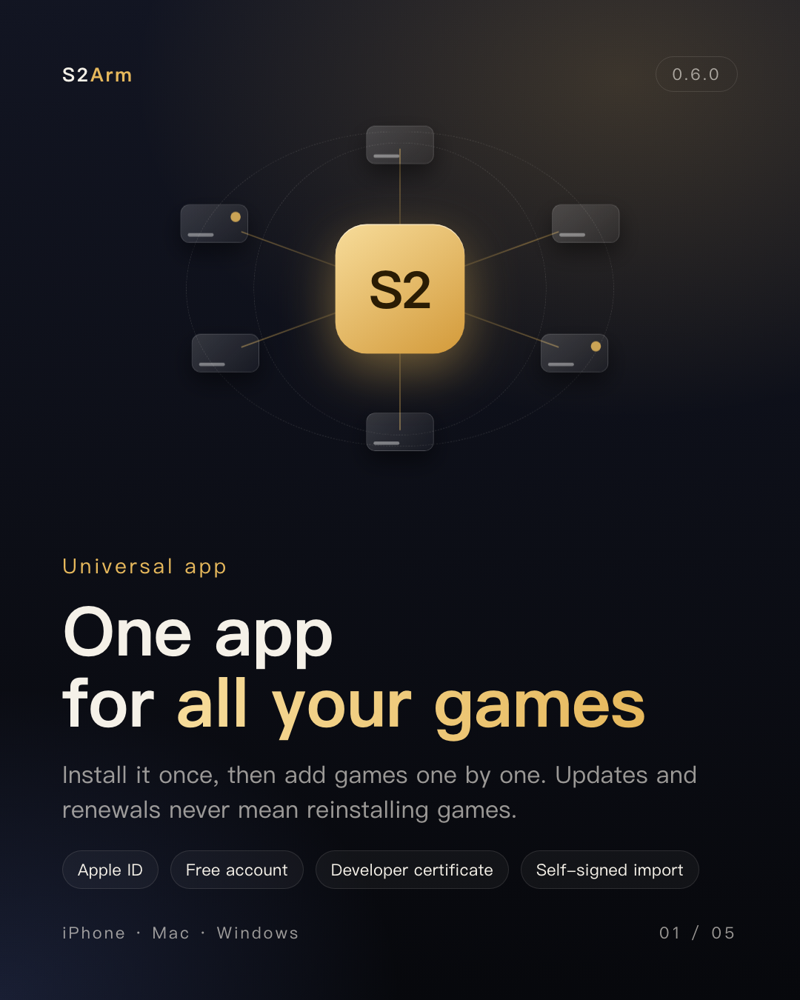
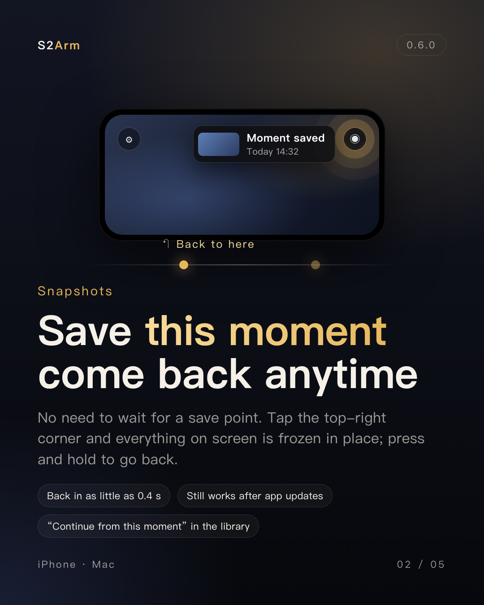

<p align="center"><a href="https://s2arm.com"></a><br><a href="https://s2arm.com">s2arm.com</a></p>

<p align="center">[简体中文](README.zh-CN.md) · [繁體中文](README.zh-TW.md) · [English](README.md) · [日本語](README.ja.md) · [Español](README.es.md) · [Français](README.fr.md)</p>

> [!NOTE]
> **[s2arm.com](https://s2arm.com) is the official S2Arm website.** S2Arm is free and open source and never accepts donations; get S2Arm only from [s2arm.com](https://s2arm.com) or this GitHub repository.

**Your own Switch games, running natively on iPhone, iPad and Mac.** Game code is rewritten to native ARM64 and runs directly on the device's processor, with graphics going straight to Metal. From 0.6.0 there is a single S2Arm app on your phone and every game lives in its library: in the Mac or Windows launcher, send games to your iPhone one by one and play.

Platforms: iPhone / iPad (iOS / iPadOS 18 and later) · Mac (Apple silicon, macOS 15 and later) · Mac or Windows launcher · License: Apache-2.0 · **Bring your own games**

[Download the launcher](https://s2arm.com) · [All releases](https://github.com/jhaizhou-ops/S2Arm/releases) · [Evidence](docs/validation/EVIDENCE.md)

<p align="center"></p>

## What's new in 0.6.0

### One app for all your games

Install S2Arm on your phone once, then add games one by one. Updating or renewing S2Arm never means installing your games again, and your saves stay. Sign with a free or paid Apple ID or a developer certificate, or sign it yourself and import it.

### Snapshots: save this moment, come back any time

No need to wait for the game's own save point. In a game, tap the ◉ in the top-right corner to save the moment you're in; press and hold it and choose Go back to the saved moment to return. Next time, Continue from this moment at the top of the library takes you straight there.

- Each game keeps only the latest snapshot; a new one replaces the old.
- A snapshot takes storage on your phone (the size depends on the game). Press and hold to delete it and free the space, or turn snapshots off in Settings.
- A snapshot only works on the device that saved it, and still works after you update S2Arm.

<p align="center"></p>

### One file, any of your devices

Export any game as a .s2arm file and import it on another of your devices to play; the phone signs it by itself. Each game keeps one copy of its files, and Free up space shows what games, saves and snapshots take.

### Every shader, ready from the first play

Shaders the game needs are prepared when you send it, so new areas no longer stutter the first time. Player diagnostics collected **26,809** shaders from 69 games that failed to compile on the device. Leaving out 278 damaged inputs that can't be read as shaders, **all 26,531** of the rest now compile.

How it is counted: the rate covers only shaders that **had failed to compile** in player diagnostics; it is not a coverage rate for all shaders. Of the remaining 98, 91 were not shaders at all but memory read wrongly during capture (capture fixed), and the other 7 have been fixed at the root.

Note: on iPhone, precompiled pipelines are generated only when you Push to iPhone with that iPhone connected. When exporting for self-signing (no iPhone connected) or with several iPhones connected, this version still compiles them the first time they are needed, as in 0.5. This will improve in a later version.

### Fixes, performance and graphics

From 0.5.0 to 0.6.0 (how each number is counted is in the table):

| | Number | How it's counted |
|---|---|---|
| Fixes merged | **344** | Fix commits merged into main after 0.5.0 |
| Player reports handled | **156** | Feedback issues closed after 0.5.0 |
| Community contributions | **126** | Pull requests from players and developers |
| GPU render time | **−50%** | Deferred-lighting scene, 4.8–5.9 ms → 2.7 ms |
| Build memory peak | **−35%** | Peak memory while building large games |

Also: several kinds of shader problems fixed at the root, more reliable loading and saving, smoother frame generation, and steadier app install, signing and sending on Windows and Mac. Thank you to every player who reported a problem.

## Getting started

1. Download the Mac or Windows launcher from [s2arm.com](https://s2arm.com) and open it.
2. Import your own keys and games; put the base game, updates and DLC in one folder and import them together.
3. Connect your iPhone, click Install S2Arm on the S2Arm tile, first in the launcher's game library, sign in and sign with your Apple ID, and S2Arm goes onto your phone.
4. Pick a game and click Push to iPhone.
5. Open S2Arm on your phone and pick a game in the library.

You can also play on the Mac itself: choose This Mac. Without a cable, export a .s2arm file and put it on your phone with AirDrop or the Files app.

### Self-signing with AltStore / SideStore

Import games right on your phone, with no Apple ID sign-in on a computer and no new certificate:

1. In AltStore or SideStore settings, export your signing certificate and set a password.
2. Open S2Arm: gear → Signing certificate → Import .p12…, pick the certificate and enter the password.
3. Then put .s2arm and .img files (exported from your computer or shared by a friend) into S2Arm's Import Here folder, and play.

Note: manage each Apple ID from AltServer on only one computer. Using two makes them revoke each other's certificates, and AltStore shows "Multiple AltServers". Before the 7 days run out, just tap Refresh All in AltStore; nothing else to do in S2Arm.

### Upgrading from 0.5

The games, saves and game data already on your phone all stay. No exporting again, no sending game data again.

1. On a Mac, sign in with your Apple ID once in S2Arm (0.5 used the account signed in to Xcode; 0.6.0 signs in inside S2Arm. Windows players skip this step).
2. Connect your phone and click Update S2Arm on the S2Arm tile, first in the game library. Your saves are backed up to the computer first, then the new app goes on over the old one (same Apple ID).
3. Right after that, the same page says how many old games on this phone need one update before they play; they are all checked, so click Update these N games (or later, check the games marked Update suggested in the dashboard and click Update selected). One game at a time, it brings the saves back to the computer, pushes the new program and sends only the resources that changed; each game takes about 1–2 minutes. For games whose shader library was built by the old version, the computer rebuilds it with the new one in this step (the game's files or its Mac version must still be in your library); the first time takes from a few minutes to a few tens of minutes. You don't need S-grade optimization for this. On a Windows PC without the Metal developer tools, this step sends the old library and says why; the game still plays, and once you install them under Get this PC ready, push again to get the new library.

Until step 3 is done those games show Update once on your computer on the phone and won't open, but they aren't gone. Games installed from another computer are listed on a separate line on the same page; update them on that computer. If you used Free up space to delete a game's iPhone resource pack, build that game's iPhone package again.

If you sign the app yourself with AltStore or similar: connect the phone, click Install S2Arm on the S2Arm card first in the game library, and on the page saying you aren't signed in with an Apple ID, click Export for self-signing instead (no iPhone needed) to get the new S2Arm.ipa; install it over the old one with AltStore; import your signing certificate (SideStore: gear → Signing certificate → Get from SideStore in S2Arm; AltStore: export it in AltStore settings, then Import .p12…); finally click Send selected to iPhone in the console, or click Export for self-signing on each game and put its .s2arm and .img into Import Here.

## Let an AI drive

Both the Mac and Windows launchers expose a control interface, `s2armctl`. An AI assistant can import games, build, install, follow progress and read errors, and every step shows up in the launcher window. A companion self-check, self-fix and feedback toolkit lets the AI find a problem, apply the documented fix, and, when it cannot, package a diagnostic bundle for you to file. Watch an AI diagnose and fix a real problem end to end: [Evidence](docs/validation/EVIDENCE.md#ai-at-the-wheel)

### Have an AI do it for you

Send this to your AI assistant (it needs to be able to run commands on your computer):

> Please read https://github.com/jhaizhou-ops/S2Arm/blob/main/launchers/macos/skill/s2arm-operator/SKILL.md and then help me install my Switch game on my iPhone.

It moves forward with a few commands, and you can watch every step in the launcher window:

```bash
/Applications/S2Arm.app/Contents/Resources/s2armctl start        # open and connect to the launcher
/Applications/S2Arm.app/Contents/Resources/s2armctl next         # what to do now, who does it, and why
/Applications/S2Arm.app/Contents/Resources/s2armctl diag export ~/Desktop/S2Arm-diagnostics.zip   # export a diagnostic bundle if it cannot fix a problem
```

Anything only you can do (system permission prompts, signing in with your Apple ID, tapping Trust on your phone), the AI stops and asks you to do. On Windows, use `s2armctl.cmd` in the launcher folder with the same commands. Windows builds iPhone / iPad packages only, so report problems inside a game from the phone: tap the report button to the right of the gear at the top left in game and say which game, what you did and what you saw. The diagnostic bundle is uploaded with it.

**Something wrong inside a game** (graphics, frame rate, stutter, crashes)? Send your AI:

> Please read https://github.com/jhaizhou-ops/S2Arm/blob/main/skills/player-game-triage/SKILL.md . My S2Arm game has this problem: <describe it>. Check the settings first, then collect diagnostics; if you can change code, fix it at the root and open a PR, otherwise help me file an issue.

## Tested at scale

**211** games surveyed with a **95%** first-try build success rate. **4,700+** test runs on real iOS devices and **1,000+** on macOS. [Evidence](docs/validation/EVIDENCE.md#tested-at-scale)

## Fast, smooth, and easy on the battery

On a 16 GB MacBook Air (M3), from importing a game to a finished iPhone build, completely cold:

| Game | Game files | Shaders | Build time |
|---|---|---|---|
| A 23.5 GB action RPG | 23.5 GB | 1,222 | **6.4 min** |
| A 12.0 GB life-sim game | 12.0 GB | 9,315 | **8.6 min** |
| A 17.5 GB open-world game | 17.5 GB | 26,999 | **34 min** |

A Switch 2 game, measured on an iPhone 17 Pro Max: a **full 60 fps** while the phone is cool, **37–43 fps** once sustained load has heated it up, at about **0.15 J per frame**. [Evidence](docs/validation/EVIDENCE.md#speed-and-efficiency)

## Platforms

| Platform | Support |
|---|---|
| iPhone / iPad | iOS / iPadOS 18 and later; every game in one S2Arm app |
| Mac | Apple silicon, macOS 15 and later; the launcher installs the app and sends games, and you can also play on the Mac |
| Windows | Graphical launcher: install the app, send games, export .s2arm |

[Evidence](docs/validation/EVIDENCE.md#platforms)

## Downstream deep ports

Some games have a deep port made specially by the community. S2Arm recognizes these games: on export it shows a page explaining the option, and you can switch to the downstream project's route (importing, packing and installing are still buttons in S2Arm, with the downstream project's implementation underneath) or keep the standard route. The registry is [`pack/downstream/schemes.json`](pack/downstream/schemes.json); the contract between the two is the downstream project's document.

| Route | Project | Devices | Contract |
|---|---|---|---|
| D2R-Mobile | [jhaizhou-ops/d2r-mobile](https://github.com/jhaizhou-ops/d2r-mobile) | iPhone / iPad (iOS 26 and later; Android and HarmonyOS in progress) | [docs/S2ARM.md](https://github.com/jhaizhou-ops/d2r-mobile/blob/main/docs/S2ARM.md) |

## Honest boundaries

S2Arm runs 64-bit (AArch64) games. Apple silicon cannot execute 32-bit ARM code, so 32-bit games are outside what S2Arm supports, as are games that need a 36-bit address space.

## Development

[Contributing](CONTRIBUTING.md) · [AI collaboration policy](LLM_POLICY.md) · [Diagnosis and root-fix skills for AI](skills/) · [Report a problem](https://github.com/jhaizhou-ops/S2Arm/issues) · [Third-party licenses](THIRD_PARTY_LICENSES.md)

## Thanks

S2Arm stands on the shoulders of its community.

- **Co-developers**: thank you to everyone who has opened a pull request or issue in this project. Your code, device testing and bug reports shaped S2Arm (in order of first contribution): [@biglawine](https://github.com/biglawine), [@yyan160](https://github.com/yyan160), [@DanielZhangyc](https://github.com/DanielZhangyc), [@vickwv](https://github.com/vickwv), [@Xc1Ym](https://github.com/Xc1Ym), [@fjack](https://github.com/fjack), [@ha7rock](https://github.com/ha7rock), [@yourmoonlight](https://github.com/yourmoonlight), [@qidian99](https://github.com/qidian99), [@n06ody](https://github.com/n06ody), [@YTwsy](https://github.com/YTwsy), [@wdjwxh](https://github.com/wdjwxh), [@realskyrin](https://github.com/realskyrin), [@wwmogu](https://github.com/wwmogu), [@quancunlau](https://github.com/quancunlau), [@moongrant](https://github.com/moongrant), [@imyinyx](https://github.com/imyinyx), [@s-leeq](https://github.com/s-leeq), [@Zhangbu](https://github.com/Zhangbu), [@retX0](https://github.com/retX0), [@zh0ngtian](https://github.com/zh0ngtian), [@fengbird](https://github.com/fengbird), [@zsakvo](https://github.com/zsakvo), [@1500256797](https://github.com/1500256797), [@BossaMelon](https://github.com/BossaMelon), [@GayoZhao](https://github.com/GayoZhao), [@sovaly](https://github.com/sovaly), [@ruterfu](https://github.com/ruterfu), [@fyn1320068837-source](https://github.com/fyn1320068837-source), [@InTheManXG](https://github.com/InTheManXG), [@neexuan](https://github.com/neexuan), [@Catnip202X](https://github.com/Catnip202X), [@kmmao](https://github.com/kmmao), [@Darcelsan](https://github.com/Darcelsan), [@lson-lee](https://github.com/lson-lee), [@cszwdy](https://github.com/cszwdy), [@Aoldbald](https://github.com/Aoldbald), [@potpot3](https://github.com/potpot3), [@yangxiaofei819](https://github.com/yangxiaofei819), [@nevenhsu](https://github.com/nevenhsu), [@shuangwei-Ye](https://github.com/shuangwei-Ye), [@IUMonster](https://github.com/IUMonster), [@zhanggh126](https://github.com/zhanggh126), [@xiaoweili126](https://github.com/xiaoweili126), [@shenxianmq](https://github.com/shenxianmq), [@rugal7699](https://github.com/rugal7699), [@painkiller2049](https://github.com/painkiller2049), [@tommy762](https://github.com/tommy762), [@tiannip](https://github.com/tiannip), [@Tiaoge-tou](https://github.com/Tiaoge-tou), [@skyezhangF](https://github.com/skyezhangF), [@DDDDEEP](https://github.com/DDDDEEP), [@CJohnSnow](https://github.com/CJohnSnow), [@shanaiardor](https://github.com/shanaiardor), [@wehnes](https://github.com/wehnes), [@SantaJiang](https://github.com/SantaJiang), [@orzdesu](https://github.com/orzdesu), [@shengyifan](https://github.com/shengyifan), [@QBYLHQ](https://github.com/QBYLHQ), [@kurtzou1](https://github.com/kurtzou1), [@TravelC](https://github.com/TravelC), [@f\*\*\*\*\*\*\*](https://github.com/fucknima), [@mizukico](https://github.com/mizukico), [@turtle4512](https://github.com/turtle4512), [@CrazyBunQnQ](https://github.com/CrazyBunQnQ), [@lwjailjq-spec](https://github.com/lwjailjq-spec), [@hkk818](https://github.com/hkk818), [@AirEcho825](https://github.com/AirEcho825), [@asdaffeqqr](https://github.com/asdaffeqqr), [@jazz-zzzz](https://github.com/jazz-zzzz), [@Canon329](https://github.com/Canon329), [@llpgf](https://github.com/llpgf), [@wyx813562408](https://github.com/wyx813562408), [@GirlNet](https://github.com/GirlNet), [@yangliguo7](https://github.com/yangliguo7), [@vuongtqchip](https://github.com/vuongtqchip), [@danielmx98](https://github.com/danielmx98), [@vpromise](https://github.com/vpromise), [@starlighteryuan-rgb](https://github.com/starlighteryuan-rgb), [@Jean-Zhang999](https://github.com/Jean-Zhang999), [@devinhurry](https://github.com/devinhurry), [@zhaobenshan-cmd](https://github.com/zhaobenshan-cmd), [@ethan-unplugged](https://github.com/ethan-unplugged), [@huanhuxilu](https://github.com/huanhuxilu), [@Y2JING](https://github.com/Y2JING), [@lin465](https://github.com/lin465), [@ZEERDEER](https://github.com/ZEERDEER), [@Haseenesss](https://github.com/Haseenesss), [@xavierskip](https://github.com/xavierskip), [@Levier007](https://github.com/Levier007), [@XuanLIN0224](https://github.com/XuanLIN0224), [@kaiying1994](https://github.com/kaiying1994), [@zhaozhen197](https://github.com/zhaozhen197), [@igobypc](https://github.com/igobypc), [@nimohe](https://github.com/nimohe), [@Glaucus-Kwok](https://github.com/Glaucus-Kwok), [@1614912120](https://github.com/1614912120), [@sofaseakk](https://github.com/sofaseakk), [@Eylock](https://github.com/Eylock), [@tututuhehehe](https://github.com/tututuhehehe), [@dovelflab](https://github.com/dovelflab), [@daiadong](https://github.com/daiadong), [@l1uvu](https://github.com/l1uvu), [@torg20](https://github.com/torg20), [@2k002](https://github.com/2k002), [@rzhang-tech](https://github.com/rzhang-tech), [@edwardzgy](https://github.com/edwardzgy), [@sevenspan](https://github.com/sevenspan), [@unionpacificy](https://github.com/unionpacificy), [@wendaocode](https://github.com/wendaocode), [@zhegemimahaolihai666](https://github.com/zhegemimahaolihai666), [@rhotov](https://github.com/rhotov), [@Arvinnma](https://github.com/Arvinnma), [@abissa](https://github.com/abissa), [@ckuffff](https://github.com/ckuffff), [@xiaopebaka](https://github.com/xiaopebaka), [@xiaoxiaocos](https://github.com/xiaoxiaocos), [@BTFKM](https://github.com/BTFKM), [@UKhhh](https://github.com/UKhhh), [@bagasromadon](https://github.com/bagasromadon), [@wangkoukouX](https://github.com/wangkoukouX), [@Klien-m](https://github.com/Klien-m), [@hycailxy](https://github.com/hycailxy), [@CCCGoat](https://github.com/CCCGoat), [@NJimmi](https://github.com/NJimmi), [@qooxxp](https://github.com/qooxxp), [@lhailiang20-hue](https://github.com/lhailiang20-hue), [@lucaAce1024](https://github.com/lucaAce1024), [@dejavuwl](https://github.com/dejavuwl), [@KANATA23333](https://github.com/KANATA23333), [@wowkiseki](https://github.com/wowkiseki), [@wcashew](https://github.com/wcashew), [@Chidober](https://github.com/Chidober), [@Orreroem](https://github.com/Orreroem), [@XIAMI2016](https://github.com/XIAMI2016), [@StrayDogA8](https://github.com/StrayDogA8), [@HFYKratos](https://github.com/HFYKratos), [@iriotssos](https://github.com/iriotssos), [@oneincase](https://github.com/oneincase), [@hx23840](https://github.com/hx23840).
- **Virtual gamepad and gear menu**: the in-game gear menu and in-place gamepad editing on iOS follow the MeloNX-style design that [@neexuan](https://github.com/neexuan) brought in [#134](https://github.com/jhaizhou-ops/S2Arm/pull/134); S2Arm reimplemented it from scratch. Thanks to MeloNX for exploring this interaction on iOS.
- **Ryujinx** (Ryujinx Team and Contributors, MIT): upstream for system services and shader translation; S2Arm's compatibility layer is built on it.
- **[NX2Apple](https://github.com/LNPANDY/NX2Apple)** (LNPANDY, MIT): upstream of the launcher interface.
- **[nxnative](https://github.com/seedds/nxnative)** (seedds, MIT, Copyright (c) 2026 seedds): the original work behind the direct graphics layer that connects game graphics straight to Metal. That generous release is what made the direct path possible. Its fork **[kartnative](https://github.com/pahorema/kartnative)** (MIT) is where the placement-sparse tile sharing for large sparse textures comes from.
- **[d2r-mobile](https://github.com/jhaizhou-ops/d2r-mobile)** (MIT): pioneered this technical path, bringing your own Switch game natively to iPhone, iPad, Mac, Android and HarmonyOS for the first time.
- **Impactor** (Samara M, MIT) and **apple-codesign** (MPL-2.0): signing and installing from Windows.
- **LNPANDY** and the original authors and contributors of the iOS library shell: the shell and its RomFS archive subsystem.
- **ns2pro-bridge** (DanielZhangyc, MIT), **MacNativeGames** (MIT), **LumaDock** (MIT), **deko3d** (fincs, zlib), **nvn.h** (h1k421, MIT), **bcdec** (Sergii Kudlai, MIT / Unlicense), **SPIRV-Cross** and **Vulkan-Headers** (The Khronos Group), **SMAA** (Jorge Jimenez et al., MIT), the **Mesa** tessellator (Microsoft, MIT), **Capstone**, **LZ4**, **.NET**, **libvpx**, **libopus**, **dav1d**, and the **Noto** fonts.

Versions, full license texts and what each component does are in [NOTICE](NOTICE) and the [third-party license list](THIRD_PARTY_LICENSES.md).

## Star History

<a href="https://star-history.com/#jhaizhou-ops/S2Arm&Date"><picture><source media="(prefers-color-scheme: dark)" srcset="https://api.star-history.com/svg?repos=jhaizhou-ops/S2Arm&type=Date&theme=dark" /></picture></a>

## License and legal

S2Arm is open source under the [Apache License 2.0](LICENSE). The project ships no games and no keys; obtain your own game files legally. S2Arm is not affiliated with or endorsed by Nintendo, and game titles and trademarks belong to their respective owners.
