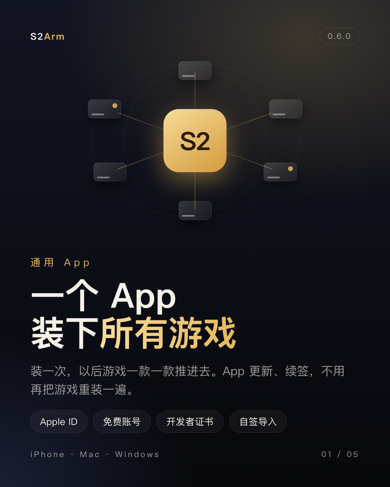
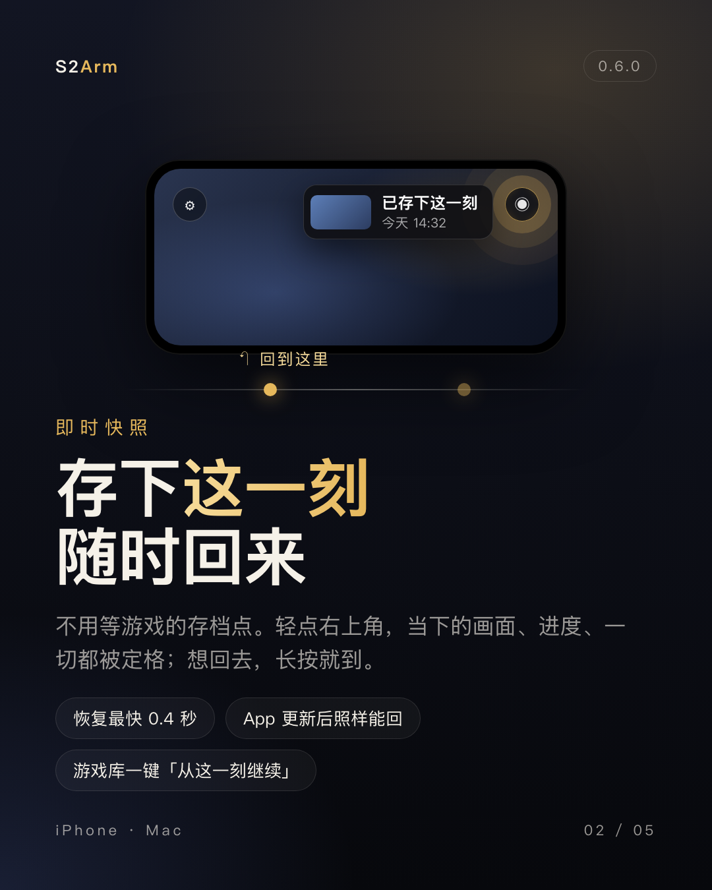

<p align="center"><a href="https://s2arm.com"></a><br><a href="https://s2arm.com">s2arm.com</a></p>

<p align="center">[简体中文](README.zh-CN.md) · [繁體中文](README.zh-TW.md) · [English](README.md) · [日本語](README.ja.md) · [Español](README.es.md) · [Français](README.fr.md)</p>

> [!NOTE]
> **[s2arm.com](https://s2arm.com) 是 S2Arm 的官方网站。** S2Arm 免费开源，从不接受任何捐赠；请只从 [s2arm.com](https://s2arm.com) 或本 GitHub 仓库获取 S2Arm。

**把你自己的 Switch 游戏，原生带到 iPhone、iPad 和 Mac。** 游戏代码改写成原生 ARM64，直接在设备的处理器上执行；图形直连 Metal。0.6.0 起，手机上只装一个 S2Arm App，所有游戏都在它的游戏库里；在 Mac 或 Windows 的启动器里把游戏一款一款「推到 iPhone」就能玩。

平台：iPhone / iPad（iOS / iPadOS 18 起）· Mac（Apple 芯片，macOS 15 起）· Mac 或 Windows 启动器 · 许可：Apache-2.0 · **游戏原件自备**

[下载启动器](https://s2arm.com) · [全部版本](https://github.com/jhaizhou-ops/S2Arm/releases) · [证据页](docs/validation/证据.md)

<p align="center"></p>

## 0.6.0 有什么新东西

### 一个 App，装下所有游戏

手机上只装一次 S2Arm，以后游戏一款一款推进去。S2Arm 更新、续签，都不用把游戏重装一遍，存档也都在。签名可以用免费或付费的 Apple ID、开发者证书，也可以自己签名后导入。

### 即时快照：存下这一刻，随时回来

不用等游戏自己的存档点。游戏里轻点右上角的 ◉，当下这一刻就被存下来；长按它，选「回到上次存下的这一刻」就回去。下次打开游戏库，最上面的「从这一刻继续」点一下直接进。

- 每款游戏只留最新的一份，新存的会盖掉旧的。
- 一份快照会占用手机空间（大小因游戏而异），长按就能删除、腾出空间；设置里也能关掉。
- 快照只在存下它的那台设备上能用；S2Arm 更新之后照样能回去。

<p align="center"></p>

### 一个文件，换台设备接着玩

每款游戏可以导出成 .s2arm 文件，放到你的另一台设备上导入就能玩，手机会自己完成签名。一款游戏只占一份空间，游戏、存档、快照各占多少，在「释放空间」里一目了然。

### 着色器全覆盖：第一次玩就流畅

推游戏时就把游戏要用的着色器备好，第一次进新场景不再卡一下。玩家诊断里收集到 69 款游戏在设备上现编失败的着色器共 **26,809** 个：除去 278 个本身已损坏、读不成着色器的输入，其余 **26,531** 个现在**全部**能编出。

口径：这个比例只算玩家诊断里**历史上编译失败过的**着色器，不是全部着色器的覆盖率。剩下的 98 个里，91 个是抓取时读错了内存、本来就不是着色器（抓取已修），另外 7 个已根修。

注意：iPhone 上的预编管线要在电脑连着这台 iPhone「推到 iPhone」时才会生成；导出自签包（不连手机）或同时连着多台 iPhone 时，这一版仍是第一次遇到时现编，和 0.5 一样，后续版本会改进。

### 修复、性能和画面

从 0.5.0 到 0.6.0（口径见下）：

| | 数字 | 口径 |
|---|---|---|
| 修复合入 | **344** 项 | 0.5.0 发布后合入 main 的修复提交 |
| 玩家反馈处理 | **156** 条 | 0.5.0 发布后关闭的反馈帖 |
| 社区贡献合入 | **126** 份 | 来自玩家与开发者的 PR |
| GPU 渲染耗时 | **−50%** | 延迟光照场景，4.8–5.9 ms → 2.7 ms |
| 出包内存峰值 | **−35%** | 大型游戏出包时的内存峰值 |

另外还有：多类着色器问题根修、读档存档更可靠、补帧更顺，Windows 和 Mac 上装 App、签名、推送更稳。感谢每一位反馈问题的玩家。

## 开始使用

1. 从 [s2arm.com](https://s2arm.com) 下载 Mac 或 Windows 启动器，打开即用。
2. 导入你自己的密钥和游戏；本体、更新和 DLC 放在同一个文件夹里一次导入。
3. 连上 iPhone，在启动器游戏库第一格的「S2Arm」里点「安装 S2Arm」，用你的 Apple ID 登录、签名，把 S2Arm 装到手机上。
4. 选一款游戏，点「推到 iPhone」。
5. 在手机上打开 S2Arm，在游戏库里选游戏开玩。

在 Mac 上也能直接玩：选「这台 Mac」即可。不连手机的话，可以导出 .s2arm 文件，用 AirDrop 或「文件」App 放到手机上导入。

### 用 AltStore / SideStore 自签

不用电脑登录 Apple ID、也不用新建证书，手机上就能导入游戏：

1. 在 AltStore 或 SideStore 的设置里「导出签名证书」，设一个密码。
2. 打开 S2Arm：齿轮 →「签名证书」→「导入 .p12…」，选这份证书，输入密码。
3. 之后把电脑导出的或朋友分享的 .s2arm 和 .img 放进 S2Arm 的「放这里导入」，就能玩。

注意：同一个 Apple ID 只在一台电脑的 AltServer 上管理；两台电脑都用会互相作废证书，AltStore 会弹「Multiple AltServers」。7 天到期前在 AltStore 点「Refresh All」即可，S2Arm 里不用再做什么。

### 从 0.5 升级

你手机上原来的游戏、存档和游戏数据都会留着，不用重新出包，也不用重传游戏数据。

1. Mac 玩家先在 S2Arm 里用 Apple ID 登录一次（0.5 用的是 Xcode 里的账号，0.6.0 改成直接在 S2Arm 里登录；Windows 玩家不用多做这一步）。
2. 连上手机，在游戏库第一格的「S2Arm」里点「更新 S2Arm」：会先把各款存档备份到电脑，再换成新 App。用同一个 Apple ID 就是覆盖安装。
3. 装完后同一页会提示「这台手机上有 N 款旧游戏，要更新一次才能玩」，默认全勾，点「更新这 N 款」（之后也可以在总控台勾上标着「建议更新」的游戏，点「更新所选」）：每款依次把存档拉回电脑、推上新版程序，资源只补变了的，每款约 1–2 分钟。着色器库还是旧版做的游戏，电脑会在这一步按新版重做（要游戏库里还有这款的游戏文件或 Mac 版），第一次要几分钟到几十分钟。不用点 S 级优化。Windows 电脑没装 Metal 开发工具时，这一步照推旧库并写明原因，游戏照样能玩；在「准备这台电脑」里装好后再推一次就换上新库。

第 3 步做完之前，这些游戏在手机上会显示「在电脑上更新一次」，点不进去，但没丢。别的电脑装的游戏，同一页会另起一行列出，到装它们的那台电脑上更新。用「释放空间」删过 iPhone 资源包的游戏，要重新打这款的 iPhone 包。

用 AltStore 等自己签名的玩家：连上手机，在游戏库第一格「S2Arm」里点「安装 S2Arm」，在提示还没登录 Apple ID 的那一页点「改为导出自签包（不用连手机）」，得到新版 S2Arm.ipa，用 AltStore 装上覆盖旧的；再导入签名证书（SideStore 在 S2Arm 齿轮 →「签名证书」里点「从 SideStore 获取」；AltStore 在它的设置里导出证书后点「导入 .p12…」）；最后在总控台点「推所选到 iPhone」，或对每款点「导出自签包」，把 .s2arm 和 .img 放进「放这里导入」。

## AI 可以直接驾驶

Mac 和 Windows 启动器都开放了控制接口 `s2armctl`：AI 助手可以导入游戏、出包、装机、查进度、读错误，每一步都在启动器窗口里看得见。配套的自查、自修与反馈工具包让 AI 自己定位问题、按处方修复，修不好就整理出诊断包交给你提交。看 AI 诊断并修好一个真实问题的完整实录：[证据](docs/validation/证据.md#ai-驾驶)

### 让 AI 帮你操作

把这句话发给你的 AI 助手（需要它能在你的电脑上执行命令）：

> 请阅读 https://github.com/jhaizhou-ops/S2Arm/blob/main/launchers/macos/skill/s2arm-operator/SKILL.md ，然后帮我把我的 Switch 游戏装到 iPhone 上。

它会用这几条命令一步步推进，你在启动器窗口里看得到每一步：

```bash
/Applications/S2Arm.app/Contents/Resources/s2armctl start        # 打开并连上启动器
/Applications/S2Arm.app/Contents/Resources/s2armctl next         # 现在该做什么、谁来做、为什么
/Applications/S2Arm.app/Contents/Resources/s2armctl diag export ~/Desktop/S2Arm-诊断.zip   # 修不好时导出诊断包
```

需要你本人做的事（系统授权、登录 Apple ID、在手机上点「信任」），AI 会停下来告诉你。Windows 上用启动器文件夹里的 `s2armctl.cmd`，命令相同。Windows 只出 iPhone / iPad 包，游戏里的问题请在手机上报：点游戏里左上角齿轮右边的报修按钮，写清哪款游戏、做了什么、看到了什么，诊断包会一起传上来。

**游戏里出了问题**（画面、帧率、卡顿、闪退）？把这句话发给 AI：

> 请阅读 https://github.com/jhaizhou-ops/S2Arm/blob/main/skills/player-game-triage/SKILL.md 。我在 S2Arm 里玩的游戏出了这个问题：<描述现象>。先帮我查设置、收诊断；你能改代码就按里面的方法根修并提 PR，修不了就帮我整理成 Issue。

## 经过大规模真机检验

**211** 款游戏完成普查，一次出包成功率 **95%**。**4700+** 局 iOS 真机测试，**1000+** 局 macOS 测试。[证据](docs/validation/证据.md#大规模真机检验)

## 快、顺、省电

在一台 16 GB 内存的 MacBook Air（M3）上，从导入游戏到出好 iPhone 包，全程冷启动：

| 游戏 | 原件 | 着色器 | 出包用时 |
|---|---|---|---|
| 一款 23.5 GB 的动作角色扮演游戏 | 23.5 GB | 1,222 | **6.4 分钟** |
| 一款 12.0 GB 的生活模拟游戏 | 12.0 GB | 9,315 | **8.6 分钟** |
| 一款 17.5 GB 的开放世界游戏 | 17.5 GB | 26,999 | **34 分钟** |

一款 Switch 2 游戏在 iPhone 17 Pro Max 上真机实测，手机未发热时**满 60 帧**，持续高负载发热后 **37～43 帧**，每帧耗电约 **0.15 焦耳**。[证据](docs/validation/证据.md#速度与能效)

## 覆盖面

| 平台 | 支持 |
|---|---|
| iPhone / iPad | iOS / iPadOS 18 起；一个 S2Arm App 里装所有游戏 |
| Mac | Apple 芯片，macOS 15 起；启动器装 App、推游戏，也能直接在 Mac 上玩 |
| Windows | 图形启动器：装 App、推游戏、导出 .s2arm |

[证据](docs/validation/证据.md#平台与系统)

## 下游深度方案

有的游戏有社区专门做的深度移植。S2Arm 认得出这些游戏：导出时弹一页说明，你可以改用下游项目的方案（导入、出包、装机仍在 S2Arm 里点按钮完成，底层换成下游项目的实现），也可以照常用原版方案。登记表在 [`pack/downstream/schemes.json`](pack/downstream/schemes.json)，两边的约定以下游项目的说明为准。

| 方案 | 项目 | 终端 | 约定 |
|---|---|---|---|
| D2R-Mobile | [jhaizhou-ops/d2r-mobile](https://github.com/jhaizhou-ops/d2r-mobile) | iPhone / iPad（iOS 26 起；安卓、鸿蒙接入中） | [docs/S2ARM.zh-CN.md](https://github.com/jhaizhou-ops/d2r-mobile/blob/main/docs/S2ARM.zh-CN.md) |

## 诚实的边界

S2Arm 运行 64 位（AArch64）游戏。Apple 芯片不能执行 32 位 ARM 代码，所以 32 位游戏不在支持范围内；需要 36 位地址空间的游戏同样不在支持范围内。

## 参与开发

[贡献指南](CONTRIBUTING.md) · [AI 协作规范](LLM_POLICY.md) · [给 AI 的诊断与根修 skills](skills/) · [问题回报](https://github.com/jhaizhou-ops/S2Arm/issues) · [第三方许可](THIRD_PARTY_LICENSES.md)

## 致谢

S2Arm 站在社区的肩膀上。

- **联合开发者**：感谢每一位在本项目提交过 PR 或 Issue 的人，你们的代码、真机测试和问题报告塑造了今天的 S2Arm（按首次贡献时间）：[@biglawine](https://github.com/biglawine), [@yyan160](https://github.com/yyan160), [@DanielZhangyc](https://github.com/DanielZhangyc), [@vickwv](https://github.com/vickwv), [@Xc1Ym](https://github.com/Xc1Ym), [@fjack](https://github.com/fjack), [@ha7rock](https://github.com/ha7rock), [@yourmoonlight](https://github.com/yourmoonlight), [@qidian99](https://github.com/qidian99), [@n06ody](https://github.com/n06ody), [@YTwsy](https://github.com/YTwsy), [@wdjwxh](https://github.com/wdjwxh), [@realskyrin](https://github.com/realskyrin), [@wwmogu](https://github.com/wwmogu), [@quancunlau](https://github.com/quancunlau), [@moongrant](https://github.com/moongrant), [@imyinyx](https://github.com/imyinyx), [@s-leeq](https://github.com/s-leeq), [@Zhangbu](https://github.com/Zhangbu), [@retX0](https://github.com/retX0), [@zh0ngtian](https://github.com/zh0ngtian), [@fengbird](https://github.com/fengbird), [@zsakvo](https://github.com/zsakvo), [@1500256797](https://github.com/1500256797), [@BossaMelon](https://github.com/BossaMelon), [@GayoZhao](https://github.com/GayoZhao), [@sovaly](https://github.com/sovaly), [@ruterfu](https://github.com/ruterfu), [@fyn1320068837-source](https://github.com/fyn1320068837-source), [@InTheManXG](https://github.com/InTheManXG), [@neexuan](https://github.com/neexuan), [@Catnip202X](https://github.com/Catnip202X), [@kmmao](https://github.com/kmmao), [@Darcelsan](https://github.com/Darcelsan), [@lson-lee](https://github.com/lson-lee), [@cszwdy](https://github.com/cszwdy), [@Aoldbald](https://github.com/Aoldbald), [@potpot3](https://github.com/potpot3), [@yangxiaofei819](https://github.com/yangxiaofei819), [@nevenhsu](https://github.com/nevenhsu), [@shuangwei-Ye](https://github.com/shuangwei-Ye), [@IUMonster](https://github.com/IUMonster), [@zhanggh126](https://github.com/zhanggh126), [@xiaoweili126](https://github.com/xiaoweili126), [@shenxianmq](https://github.com/shenxianmq), [@rugal7699](https://github.com/rugal7699), [@painkiller2049](https://github.com/painkiller2049), [@tommy762](https://github.com/tommy762), [@tiannip](https://github.com/tiannip), [@Tiaoge-tou](https://github.com/Tiaoge-tou), [@skyezhangF](https://github.com/skyezhangF), [@DDDDEEP](https://github.com/DDDDEEP), [@CJohnSnow](https://github.com/CJohnSnow), [@shanaiardor](https://github.com/shanaiardor), [@wehnes](https://github.com/wehnes), [@SantaJiang](https://github.com/SantaJiang), [@orzdesu](https://github.com/orzdesu), [@shengyifan](https://github.com/shengyifan), [@QBYLHQ](https://github.com/QBYLHQ), [@kurtzou1](https://github.com/kurtzou1), [@TravelC](https://github.com/TravelC), [@f\*\*\*\*\*\*\*](https://github.com/fucknima), [@mizukico](https://github.com/mizukico), [@turtle4512](https://github.com/turtle4512), [@CrazyBunQnQ](https://github.com/CrazyBunQnQ), [@lwjailjq-spec](https://github.com/lwjailjq-spec), [@hkk818](https://github.com/hkk818), [@AirEcho825](https://github.com/AirEcho825), [@asdaffeqqr](https://github.com/asdaffeqqr), [@jazz-zzzz](https://github.com/jazz-zzzz), [@Canon329](https://github.com/Canon329), [@llpgf](https://github.com/llpgf), [@wyx813562408](https://github.com/wyx813562408), [@GirlNet](https://github.com/GirlNet), [@yangliguo7](https://github.com/yangliguo7), [@vuongtqchip](https://github.com/vuongtqchip), [@danielmx98](https://github.com/danielmx98), [@vpromise](https://github.com/vpromise), [@starlighteryuan-rgb](https://github.com/starlighteryuan-rgb), [@Jean-Zhang999](https://github.com/Jean-Zhang999), [@devinhurry](https://github.com/devinhurry), [@zhaobenshan-cmd](https://github.com/zhaobenshan-cmd), [@ethan-unplugged](https://github.com/ethan-unplugged), [@huanhuxilu](https://github.com/huanhuxilu), [@Y2JING](https://github.com/Y2JING), [@lin465](https://github.com/lin465), [@ZEERDEER](https://github.com/ZEERDEER), [@Haseenesss](https://github.com/Haseenesss), [@xavierskip](https://github.com/xavierskip), [@Levier007](https://github.com/Levier007), [@XuanLIN0224](https://github.com/XuanLIN0224), [@kaiying1994](https://github.com/kaiying1994), [@zhaozhen197](https://github.com/zhaozhen197), [@igobypc](https://github.com/igobypc), [@nimohe](https://github.com/nimohe), [@Glaucus-Kwok](https://github.com/Glaucus-Kwok), [@1614912120](https://github.com/1614912120), [@sofaseakk](https://github.com/sofaseakk), [@Eylock](https://github.com/Eylock), [@tututuhehehe](https://github.com/tututuhehehe), [@dovelflab](https://github.com/dovelflab), [@daiadong](https://github.com/daiadong), [@l1uvu](https://github.com/l1uvu), [@torg20](https://github.com/torg20), [@2k002](https://github.com/2k002), [@rzhang-tech](https://github.com/rzhang-tech), [@edwardzgy](https://github.com/edwardzgy), [@sevenspan](https://github.com/sevenspan), [@unionpacificy](https://github.com/unionpacificy), [@wendaocode](https://github.com/wendaocode), [@zhegemimahaolihai666](https://github.com/zhegemimahaolihai666), [@rhotov](https://github.com/rhotov), [@Arvinnma](https://github.com/Arvinnma), [@abissa](https://github.com/abissa), [@ckuffff](https://github.com/ckuffff), [@xiaopebaka](https://github.com/xiaopebaka), [@xiaoxiaocos](https://github.com/xiaoxiaocos), [@BTFKM](https://github.com/BTFKM), [@UKhhh](https://github.com/UKhhh), [@bagasromadon](https://github.com/bagasromadon), [@wangkoukouX](https://github.com/wangkoukouX), [@Klien-m](https://github.com/Klien-m), [@hycailxy](https://github.com/hycailxy), [@CCCGoat](https://github.com/CCCGoat), [@NJimmi](https://github.com/NJimmi), [@qooxxp](https://github.com/qooxxp), [@lhailiang20-hue](https://github.com/lhailiang20-hue), [@lucaAce1024](https://github.com/lucaAce1024), [@dejavuwl](https://github.com/dejavuwl), [@KANATA23333](https://github.com/KANATA23333), [@wowkiseki](https://github.com/wowkiseki), [@wcashew](https://github.com/wcashew), [@Chidober](https://github.com/Chidober), [@Orreroem](https://github.com/Orreroem), [@XIAMI2016](https://github.com/XIAMI2016), [@StrayDogA8](https://github.com/StrayDogA8), [@HFYKratos](https://github.com/HFYKratos), [@iriotssos](https://github.com/iriotssos), [@oneincase](https://github.com/oneincase), [@hx23840](https://github.com/hx23840)。
- **虚拟手柄与齿轮菜单**：iOS 游戏内齿轮菜单和虚拟手柄原地编辑的交互，参考了 [@neexuan](https://github.com/neexuan) 在 [#134](https://github.com/jhaizhou-ops/S2Arm/pull/134) 带来的 MeloNX 风格设计，S2Arm 重新实现。感谢 MeloNX 在 iOS 上探索的这套交互。
- **Ryujinx**（Ryujinx Team and Contributors，MIT）：系统服务与着色器翻译的上游，S2Arm 的兼容层建立在它之上。
- **[NX2Apple](https://github.com/LNPANDY/NX2Apple)**（LNPANDY，MIT）：启动器界面的上游。
- **[nxnative](https://github.com/seedds/nxnative)**（seedds，MIT，Copyright (c) 2026 seedds）：直连图形层的原作，S2Arm 把游戏图形直接接到 Metal 的这一层源自这份工作。没有这份慷慨的开源，就没有今天的直连路线。它的分支 **[kartnative](https://github.com/pahorema/kartnative)**（MIT）是大稀疏贴图按块共享堆页做法的来源。
- **[d2r-mobile](https://github.com/jhaizhou-ops/d2r-mobile)**（MIT）：开拓了这条技术路线，第一次把自己的 Switch 游戏原生带到 iPhone、iPad、Mac、安卓和鸿蒙。
- **Impactor**（Samara M，MIT）与 **apple-codesign**（MPL-2.0）：Windows 端的签名装机。
- **LNPANDY** 及 iOS 游戏库外壳的原作者与贡献者：外壳与 RomFS 归档子系统。
- **ns2pro-bridge**（DanielZhangyc，MIT）、**MacNativeGames**（MIT）、**LumaDock**（MIT）、**deko3d**（fincs，zlib）、**nvn.h**（h1k421，MIT）、**bcdec**（Sergii Kudlai，MIT / Unlicense）、**SPIRV-Cross** 与 **Vulkan-Headers**（Khronos Group）、**SMAA**（Jorge Jimenez 等，MIT）、**Mesa** 的细分器（Microsoft，MIT）、**Capstone**、**LZ4**、**.NET**、**libvpx**、**libopus**、**dav1d** 和 **Noto** 字体。

每个组件的版本、许可全文和用途见 [NOTICE](NOTICE) 与 [第三方许可清单](THIRD_PARTY_LICENSES.md)。

## Star 走势

<a href="https://star-history.com/#jhaizhou-ops/S2Arm&Date"><picture><source media="(prefers-color-scheme: dark)" srcset="https://api.star-history.com/svg?repos=jhaizhou-ops/S2Arm&type=Date&theme=dark" /></picture></a>

## 许可与声明

S2Arm 以 [Apache License 2.0](LICENSE) 开源。本项目不提供任何游戏，也不提供密钥；游戏原件请自行合法取得。S2Arm 与 Nintendo 没有隶属或授权关系，游戏名称与商标归各自权利人所有。
