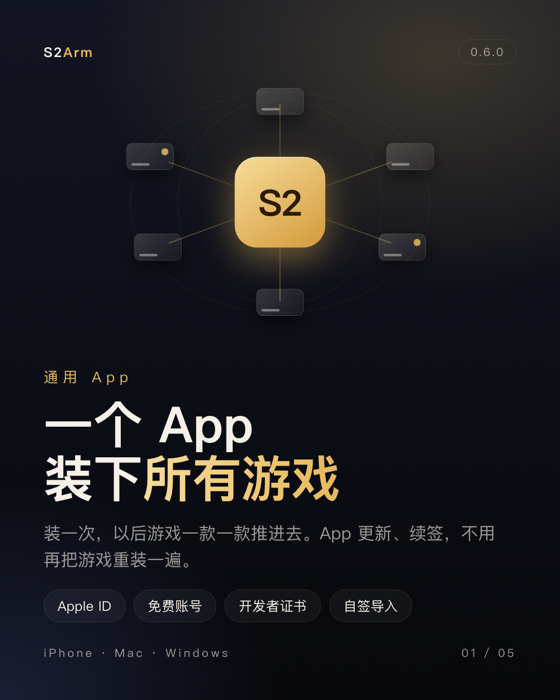
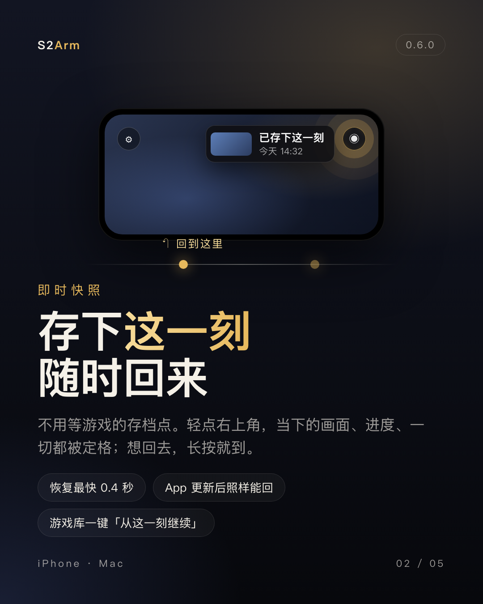

<p align="center"><a href="https://s2arm.com"></a><br><a href="https://s2arm.com">s2arm.com</a></p>

<p align="center">[简体中文](README.zh-CN.md) · [繁體中文](README.zh-TW.md) · [English](README.md) · [日本語](README.ja.md) · [Español](README.es.md) · [Français](README.fr.md)</p>

> [!NOTE]
> **[s2arm.com](https://s2arm.com) 是 S2Arm 的官方網站。** S2Arm 免費開源，從不接受任何捐贈；請只從 [s2arm.com](https://s2arm.com) 或本 GitHub 儲存庫取得 S2Arm。

**把你自己的 Switch 遊戲，原生帶到 iPhone、iPad 和 Mac。** 遊戲程式碼改寫成原生 ARM64，直接在裝置的處理器上執行；圖形直連 Metal。0.6.0 起，手機上只裝一個 S2Arm App，所有遊戲都在它的遊戲庫裡；在 Mac 或 Windows 的啟動器裡把遊戲一款一款「推到 iPhone」就能玩。

平台：iPhone / iPad（iOS / iPadOS 18 起）· Mac（Apple 晶片，macOS 15 起）· Mac 或 Windows 啟動器 · 授權：Apache-2.0 · **遊戲原件自備**

[下載啟動器](https://s2arm.com) · [全部版本](https://github.com/jhaizhou-ops/S2Arm/releases) · [證據頁](docs/validation/证据.md)

<p align="center"></p>

## 0.6.0 有什麼新東西

### 一個 App，裝下所有遊戲

手機上只裝一次 S2Arm，以後遊戲一款一款推進去。S2Arm 更新、續簽，都不用把遊戲重裝一遍，存檔也都在。簽名可以用免費或付費的 Apple ID、開發者憑證，也可以自己簽名後匯入。

### 即時快照：存下這一刻，隨時回來

不用等遊戲自己的存檔點。遊戲裡輕點右上角的 ◉，當下這一刻就被存下來；長按它，選「回到上次存下的這一刻」就回去。下次打開遊戲庫，最上面的「從這一刻繼續」點一下直接進。

- 每款遊戲只留最新的一份，新存的會蓋掉舊的。
- 一份快照會佔用手機空間（大小因遊戲而異），長按就能刪除、騰出空間；設定裡也能關掉。
- 快照只在存下它的那台裝置上能用；S2Arm 更新之後照樣能回去。

<p align="center"></p>

### 一個檔案，換台裝置接著玩

每款遊戲可以匯出成 .s2arm 檔案，放到你的另一台裝置上匯入就能玩，手機會自己完成簽名。一款遊戲只佔一份空間，遊戲、存檔、快照各佔多少，在「釋放空間」裡一目了然。

### 著色器全覆蓋：第一次玩就流暢

推遊戲時就把遊戲要用的著色器備好，第一次進新場景不再卡一下。玩家診斷裡收集到 69 款遊戲在裝置上現編失敗的著色器共 **26,809** 個：除去 278 個本身已損壞、讀不成著色器的輸入，其餘 **26,531** 個現在**全部**能編出。

口徑：這個比例只算玩家診斷裡**歷史上編譯失敗過的**著色器，不是全部著色器的覆蓋率。剩下的 98 個裡，91 個是擷取時讀錯了記憶體、本來就不是著色器（擷取已修），另外 7 個已根修。

注意：iPhone 上的預編管線要在電腦連著這台 iPhone「推到 iPhone」時才會產生；匯出自簽包（不連手機）或同時連著多台 iPhone 時，這一版仍是第一次遇到時現編，和 0.5 一樣，後續版本會改進。

### 修復、效能和畫面

從 0.5.0 到 0.6.0（口徑見下）：

| | 數字 | 口徑 |
|---|---|---|
| 修復合入 | **344** 項 | 0.5.0 發布後合入 main 的修復提交 |
| 玩家回饋處理 | **156** 條 | 0.5.0 發布後關閉的回饋帖 |
| 社群貢獻合入 | **126** 份 | 來自玩家與開發者的 PR |
| GPU 渲染耗時 | **−50%** | 延遲光照場景，4.8–5.9 ms → 2.7 ms |
| 出包記憶體峰值 | **−35%** | 大型遊戲出包時的記憶體峰值 |

另外還有：多類著色器問題根修、讀檔存檔更可靠、補幀更順，Windows 和 Mac 上裝 App、簽名、推送更穩。感謝每一位回報問題的玩家。

## 開始使用

1. 從 [s2arm.com](https://s2arm.com) 下載 Mac 或 Windows 啟動器，打開即用。
2. 匯入你自己的金鑰和遊戲；本體、更新和 DLC 放在同一個資料夾裡一次匯入。
3. 連上 iPhone，在啟動器遊戲庫第一格的「S2Arm」裡點「安裝 S2Arm」，用你的 Apple ID 登入、簽名，把 S2Arm 裝到手機上。
4. 選一款遊戲，點「推到 iPhone」。
5. 在手機上打開 S2Arm，在遊戲庫裡選遊戲開玩。

在 Mac 上也能直接玩：選「這臺 Mac」即可。不連手機的話，可以匯出 .s2arm 檔案，用 AirDrop 或「檔案」App 放到手機上匯入。

### 用 AltStore / SideStore 自簽

不用在電腦登入 Apple ID、也不用新建憑證，手機上就能匯入遊戲：

1. 在 AltStore 或 SideStore 的設定裡「匯出簽名憑證」，設一個密碼。
2. 打開 S2Arm：齒輪 →「簽名憑證」→「匯入 .p12…」，選這份憑證，輸入密碼。
3. 之後把電腦匯出的或朋友分享的 .s2arm 和 .img 放進 S2Arm 的「放这里导入」資料夾，就能玩。

注意：同一個 Apple ID 只在一台電腦的 AltServer 上管理；兩台電腦都用會互相作廢憑證，AltStore 會跳出「Multiple AltServers」。7 天到期前在 AltStore 點「Refresh All」即可，S2Arm 裡不用再做什麼。

### 從 0.5 升級

你手機上原來的遊戲、存檔和遊戲資料都會留著，不用重新出包，也不用重傳遊戲資料。

1. Mac 玩家先在 S2Arm 裡用 Apple ID 登入一次（0.5 用的是 Xcode 裡的帳號，0.6.0 改成直接在 S2Arm 裡登入；Windows 玩家不用多做這一步）。
2. 連上手機，在遊戲庫第一格的「S2Arm」裡點「更新 S2Arm」：會先把各款存檔備份到電腦，再換成新 App。用同一個 Apple ID 就是覆蓋安裝。
3. 裝完後同一頁會提示「這台手機上有 N 款舊遊戲，要更新一次才能玩」，預設全勾，點「更新這 N 款」（之後也可以在總控台勾上標著「建議更新」的遊戲，點「更新所選」）：每款依序把存檔拉回電腦、推上新版程式，資源只補變了的，每款約 1–2 分鐘。著色器庫還是舊版做的遊戲，電腦會在這一步按新版重做（要遊戲庫裡還有這款的遊戲檔案或 Mac 版），第一次要幾分鐘到幾十分鐘。不用點 S 級優化。Windows 電腦沒裝 Metal 開發工具時，這一步照推舊庫並寫明原因，遊戲照樣能玩；在「準備這臺電腦」裡裝好後再推一次就換上新庫。

第 3 步做完之前，這些遊戲在手機上會顯示「在電腦上更新一次」，點不進去，但沒丟。別的電腦裝的遊戲，同一頁會另起一行列出，到裝它們的那台電腦上更新。用「釋放空間」刪過 iPhone 資源包的遊戲，要重新打這款的 iPhone 包。

用 AltStore 等自己簽名的玩家：連上手機，在遊戲庫第一格「S2Arm」裡點「安裝 S2Arm」，在提示還沒登入 Apple ID 的那一頁點「改為匯出自簽包（不用連手機）」，得到新版 S2Arm.ipa，用 AltStore 裝上覆蓋舊的；再匯入簽名憑證（SideStore 在 S2Arm 齒輪 →「簽名憑證」裡點「從 SideStore 取得」；AltStore 在它的設定裡匯出憑證後點「匯入 .p12…」）；最後在總控台點「推所選到 iPhone」，或對每款點「匯出自簽包」，把 .s2arm 和 .img 放進「放这里导入」。

## AI 可以直接駕駛

Mac 和 Windows 啟動器都開放了控制介面 `s2armctl`：AI 助手可以匯入遊戲、出包、裝機、查進度、讀錯誤，每一步都在啟動器視窗裡看得見。配套的自查、自修與回饋工具包讓 AI 自己定位問題、按處方修復，修不好就整理出診斷包交給你提交。看 AI 診斷並修好一個真實問題的完整實錄：[證據](docs/validation/证据.md#ai-驾驶)

### 讓 AI 幫你操作

把這句話發給你的 AI 助手（需要它能在你的電腦上執行指令）：

> 請閱讀 https://github.com/jhaizhou-ops/S2Arm/blob/main/launchers/macos/skill/s2arm-operator/SKILL.md ，然後幫我把我的 Switch 遊戲裝到 iPhone 上。

它會用這幾條指令一步步推進，你在啟動器視窗裡看得到每一步：

```bash
/Applications/S2Arm.app/Contents/Resources/s2armctl start        # 打開並連上啟動器
/Applications/S2Arm.app/Contents/Resources/s2armctl next         # 現在該做什麼、誰來做、為什麼
/Applications/S2Arm.app/Contents/Resources/s2armctl diag export ~/Desktop/S2Arm-诊断.zip   # 修不好時匯出診斷包
```

需要你本人做的事（系統授權、登入 Apple ID、在手機上點「信任」），AI 會停下來告訴你。Windows 上用啟動器資料夾裡的 `s2armctl.cmd`，指令相同。Windows 只出 iPhone / iPad 包，遊戲裡的問題請在手機上回報：點遊戲裡左上角齒輪右邊的回報按鈕，寫清楚哪款遊戲、做了什麼、看到了什麼，診斷包會一起上傳。

**遊戲裡出了問題**（畫面、幀率、卡頓、閃退）？把這句話發給 AI：

> 請閱讀 https://github.com/jhaizhou-ops/S2Arm/blob/main/skills/player-game-triage/SKILL.md 。我在 S2Arm 裡玩的遊戲出了這個問題：<描述現象>。先幫我查設定、收診斷；你能改程式碼就按裡面的方法根修並提 PR，修不了就幫我整理成 Issue。

## 經過大規模真機檢驗

**211** 款遊戲完成普查，一次出包成功率 **95%**。**4700+** 局 iOS 真機測試，**1000+** 局 macOS 測試。[證據](docs/validation/证据.md#大规模真机检验)

## 快、順、省電

在一台 16 GB 記憶體的 MacBook Air（M3）上，從匯入遊戲到出好 iPhone 包，全程冷啟動：

| 遊戲 | 原件 | 著色器 | 出包用時 |
|---|---|---|---|
| 一款 23.5 GB 的動作角色扮演遊戲 | 23.5 GB | 1,222 | **6.4 分鐘** |
| 一款 12.0 GB 的生活模擬遊戲 | 12.0 GB | 9,315 | **8.6 分鐘** |
| 一款 17.5 GB 的開放世界遊戲 | 17.5 GB | 26,999 | **34 分鐘** |

一款 Switch 2 遊戲在 iPhone 17 Pro Max 上真機實測，手機未發熱時**滿 60 幀**，持續高負載發熱後 **37～43 幀**，每幀耗電約 **0.15 焦耳**。[證據](docs/validation/证据.md#速度与能效)

## 覆蓋面

| 平台 | 支援 |
|---|---|
| iPhone / iPad | iOS / iPadOS 18 起；一個 S2Arm App 裡裝所有遊戲 |
| Mac | Apple 晶片，macOS 15 起；啟動器裝 App、推遊戲，也能直接在 Mac 上玩 |
| Windows | 圖形啟動器：裝 App、推遊戲、匯出 .s2arm |

[證據](docs/validation/证据.md#平台与系统)

## 下游深度方案

有的遊戲有社群專門做的深度移植。S2Arm 認得出這些遊戲：匯出時彈一頁說明，你可以改用下游專案的方案（匯入、出包、裝機仍在 S2Arm 裡點按鈕完成，底層換成下游專案的實作），也可以照常用原版方案。登記表在 [`pack/downstream/schemes.json`](pack/downstream/schemes.json)，兩邊的約定以下游專案的說明為準。

| 方案 | 專案 | 終端 | 約定 |
|---|---|---|---|
| D2R-Mobile | [jhaizhou-ops/d2r-mobile](https://github.com/jhaizhou-ops/d2r-mobile) | iPhone / iPad（iOS 26 起；Android、鴻蒙接入中） | [docs/S2ARM.zh-CN.md](https://github.com/jhaizhou-ops/d2r-mobile/blob/main/docs/S2ARM.zh-CN.md) |

## 誠實的邊界

S2Arm 執行 64 位元（AArch64）遊戲。Apple 晶片不能執行 32 位元 ARM 程式碼，所以 32 位元遊戲不在支援範圍內；需要 36 位元位址空間的遊戲同樣不在支援範圍內。

## 參與開發

[貢獻指南](CONTRIBUTING.md) · [AI 協作規範](LLM_POLICY.md) · [給 AI 的診斷與根修 skills](skills/) · [問題回報](https://github.com/jhaizhou-ops/S2Arm/issues) · [第三方授權](THIRD_PARTY_LICENSES.md)

## 致謝

S2Arm 站在社群的肩膀上。

- **聯合開發者**：感謝每一位在本專案提交過 PR 或 Issue 的人，你們的程式碼、真機測試和問題回報塑造了今天的 S2Arm（按首次貢獻時間）：[@biglawine](https://github.com/biglawine), [@yyan160](https://github.com/yyan160), [@DanielZhangyc](https://github.com/DanielZhangyc), [@vickwv](https://github.com/vickwv), [@Xc1Ym](https://github.com/Xc1Ym), [@fjack](https://github.com/fjack), [@ha7rock](https://github.com/ha7rock), [@yourmoonlight](https://github.com/yourmoonlight), [@qidian99](https://github.com/qidian99), [@n06ody](https://github.com/n06ody), [@YTwsy](https://github.com/YTwsy), [@wdjwxh](https://github.com/wdjwxh), [@realskyrin](https://github.com/realskyrin), [@wwmogu](https://github.com/wwmogu), [@quancunlau](https://github.com/quancunlau), [@moongrant](https://github.com/moongrant), [@imyinyx](https://github.com/imyinyx), [@s-leeq](https://github.com/s-leeq), [@Zhangbu](https://github.com/Zhangbu), [@retX0](https://github.com/retX0), [@zh0ngtian](https://github.com/zh0ngtian), [@fengbird](https://github.com/fengbird), [@zsakvo](https://github.com/zsakvo), [@1500256797](https://github.com/1500256797), [@BossaMelon](https://github.com/BossaMelon), [@GayoZhao](https://github.com/GayoZhao), [@sovaly](https://github.com/sovaly), [@ruterfu](https://github.com/ruterfu), [@fyn1320068837-source](https://github.com/fyn1320068837-source), [@InTheManXG](https://github.com/InTheManXG), [@neexuan](https://github.com/neexuan), [@Catnip202X](https://github.com/Catnip202X), [@kmmao](https://github.com/kmmao), [@Darcelsan](https://github.com/Darcelsan), [@lson-lee](https://github.com/lson-lee), [@cszwdy](https://github.com/cszwdy), [@Aoldbald](https://github.com/Aoldbald), [@potpot3](https://github.com/potpot3), [@yangxiaofei819](https://github.com/yangxiaofei819), [@nevenhsu](https://github.com/nevenhsu), [@shuangwei-Ye](https://github.com/shuangwei-Ye), [@IUMonster](https://github.com/IUMonster), [@zhanggh126](https://github.com/zhanggh126), [@xiaoweili126](https://github.com/xiaoweili126), [@shenxianmq](https://github.com/shenxianmq), [@rugal7699](https://github.com/rugal7699), [@painkiller2049](https://github.com/painkiller2049), [@tommy762](https://github.com/tommy762), [@tiannip](https://github.com/tiannip), [@Tiaoge-tou](https://github.com/Tiaoge-tou), [@skyezhangF](https://github.com/skyezhangF), [@DDDDEEP](https://github.com/DDDDEEP), [@CJohnSnow](https://github.com/CJohnSnow), [@shanaiardor](https://github.com/shanaiardor), [@wehnes](https://github.com/wehnes), [@SantaJiang](https://github.com/SantaJiang), [@orzdesu](https://github.com/orzdesu), [@shengyifan](https://github.com/shengyifan), [@QBYLHQ](https://github.com/QBYLHQ), [@kurtzou1](https://github.com/kurtzou1), [@TravelC](https://github.com/TravelC), [@f\*\*\*\*\*\*\*](https://github.com/fucknima), [@mizukico](https://github.com/mizukico), [@turtle4512](https://github.com/turtle4512), [@CrazyBunQnQ](https://github.com/CrazyBunQnQ), [@lwjailjq-spec](https://github.com/lwjailjq-spec), [@hkk818](https://github.com/hkk818), [@AirEcho825](https://github.com/AirEcho825), [@asdaffeqqr](https://github.com/asdaffeqqr), [@jazz-zzzz](https://github.com/jazz-zzzz), [@Canon329](https://github.com/Canon329), [@llpgf](https://github.com/llpgf), [@wyx813562408](https://github.com/wyx813562408), [@GirlNet](https://github.com/GirlNet), [@yangliguo7](https://github.com/yangliguo7), [@vuongtqchip](https://github.com/vuongtqchip), [@danielmx98](https://github.com/danielmx98), [@vpromise](https://github.com/vpromise), [@starlighteryuan-rgb](https://github.com/starlighteryuan-rgb), [@Jean-Zhang999](https://github.com/Jean-Zhang999), [@devinhurry](https://github.com/devinhurry), [@zhaobenshan-cmd](https://github.com/zhaobenshan-cmd), [@ethan-unplugged](https://github.com/ethan-unplugged), [@huanhuxilu](https://github.com/huanhuxilu), [@Y2JING](https://github.com/Y2JING), [@lin465](https://github.com/lin465), [@ZEERDEER](https://github.com/ZEERDEER), [@Haseenesss](https://github.com/Haseenesss), [@xavierskip](https://github.com/xavierskip), [@Levier007](https://github.com/Levier007), [@XuanLIN0224](https://github.com/XuanLIN0224), [@kaiying1994](https://github.com/kaiying1994), [@zhaozhen197](https://github.com/zhaozhen197), [@igobypc](https://github.com/igobypc), [@nimohe](https://github.com/nimohe), [@Glaucus-Kwok](https://github.com/Glaucus-Kwok), [@1614912120](https://github.com/1614912120), [@sofaseakk](https://github.com/sofaseakk), [@Eylock](https://github.com/Eylock), [@tututuhehehe](https://github.com/tututuhehehe), [@dovelflab](https://github.com/dovelflab), [@daiadong](https://github.com/daiadong), [@l1uvu](https://github.com/l1uvu), [@torg20](https://github.com/torg20), [@2k002](https://github.com/2k002), [@rzhang-tech](https://github.com/rzhang-tech), [@edwardzgy](https://github.com/edwardzgy), [@sevenspan](https://github.com/sevenspan), [@unionpacificy](https://github.com/unionpacificy), [@wendaocode](https://github.com/wendaocode), [@zhegemimahaolihai666](https://github.com/zhegemimahaolihai666), [@rhotov](https://github.com/rhotov), [@Arvinnma](https://github.com/Arvinnma), [@abissa](https://github.com/abissa), [@ckuffff](https://github.com/ckuffff), [@xiaopebaka](https://github.com/xiaopebaka), [@xiaoxiaocos](https://github.com/xiaoxiaocos), [@BTFKM](https://github.com/BTFKM), [@UKhhh](https://github.com/UKhhh), [@bagasromadon](https://github.com/bagasromadon), [@wangkoukouX](https://github.com/wangkoukouX), [@Klien-m](https://github.com/Klien-m), [@hycailxy](https://github.com/hycailxy), [@CCCGoat](https://github.com/CCCGoat), [@NJimmi](https://github.com/NJimmi), [@qooxxp](https://github.com/qooxxp), [@lhailiang20-hue](https://github.com/lhailiang20-hue), [@lucaAce1024](https://github.com/lucaAce1024), [@dejavuwl](https://github.com/dejavuwl), [@KANATA23333](https://github.com/KANATA23333), [@wowkiseki](https://github.com/wowkiseki), [@wcashew](https://github.com/wcashew), [@Chidober](https://github.com/Chidober), [@Orreroem](https://github.com/Orreroem), [@XIAMI2016](https://github.com/XIAMI2016), [@StrayDogA8](https://github.com/StrayDogA8), [@HFYKratos](https://github.com/HFYKratos), [@iriotssos](https://github.com/iriotssos), [@oneincase](https://github.com/oneincase), [@hx23840](https://github.com/hx23840)。
- **虛擬手把與齒輪選單**：iOS 遊戲內齒輪選單和虛擬手把原地編輯的互動，參考了 [@neexuan](https://github.com/neexuan) 在 [#134](https://github.com/jhaizhou-ops/S2Arm/pull/134) 帶來的 MeloNX 風格設計，S2Arm 重新實作。感謝 MeloNX 在 iOS 上探索的這套互動。
- **Ryujinx**（Ryujinx Team and Contributors，MIT）：系統服務與著色器翻譯的上游，S2Arm 的相容層建立在它之上。
- **[NX2Apple](https://github.com/LNPANDY/NX2Apple)**（LNPANDY，MIT）：啟動器介面的上游。
- **[nxnative](https://github.com/seedds/nxnative)**（seedds，MIT，Copyright (c) 2026 seedds）：直連圖形層的原作，S2Arm 把遊戲圖形直接接到 Metal 的這一層源自這份工作。沒有這份慷慨的開源，就沒有今天的直連路線。它的分支 **[kartnative](https://github.com/pahorema/kartnative)**（MIT）是大型稀疏貼圖按塊共享堆積頁做法的來源。
- **[d2r-mobile](https://github.com/jhaizhou-ops/d2r-mobile)**（MIT）：開拓了這條技術路線，第一次把自己的 Switch 遊戲原生帶到 iPhone、iPad、Mac、Android 和鴻蒙。
- **Impactor**（Samara M，MIT）與 **apple-codesign**（MPL-2.0）：Windows 端的簽名裝機。
- **LNPANDY** 及 iOS 遊戲庫外殼的原作者與貢獻者：外殼與 RomFS 封存子系統。
- **ns2pro-bridge**（DanielZhangyc，MIT）、**MacNativeGames**（MIT）、**LumaDock**（MIT）、**deko3d**（fincs，zlib）、**nvn.h**（h1k421，MIT）、**bcdec**（Sergii Kudlai，MIT / Unlicense）、**SPIRV-Cross** 與 **Vulkan-Headers**（Khronos Group）、**SMAA**（Jorge Jimenez 等，MIT）、**Mesa** 的細分器（Microsoft，MIT）、**Capstone**、**LZ4**、**.NET**、**libvpx**、**libopus**、**dav1d** 和 **Noto** 字型。

每個元件的版本、授權全文和用途見 [NOTICE](NOTICE) 與 [第三方授權清單](THIRD_PARTY_LICENSES.md)。

## Star 走勢

<a href="https://star-history.com/#jhaizhou-ops/S2Arm&Date"><picture><source media="(prefers-color-scheme: dark)" srcset="https://api.star-history.com/svg?repos=jhaizhou-ops/S2Arm&type=Date&theme=dark" /></picture></a>

## 授權與聲明

S2Arm 以 [Apache License 2.0](LICENSE) 開源。本專案不提供任何遊戲，也不提供金鑰；遊戲原件請自行合法取得。S2Arm 與 Nintendo 沒有隸屬或授權關係，遊戲名稱與商標歸各自權利人所有。
